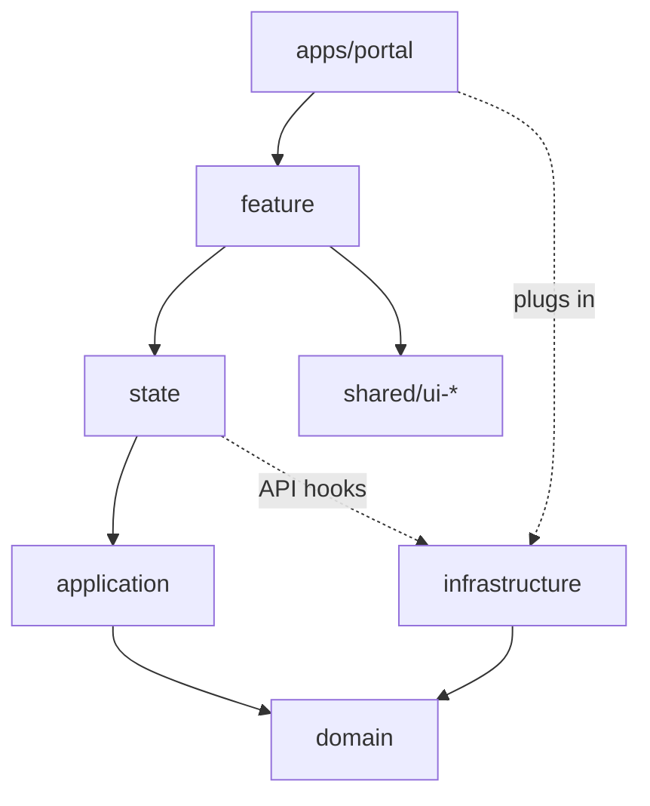
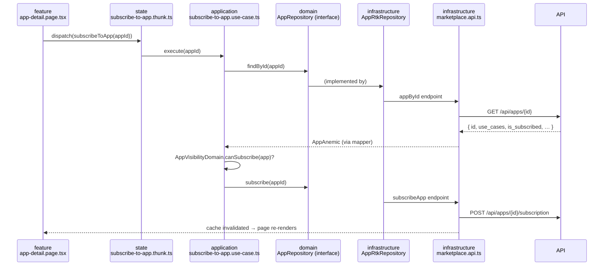

# 03 – Layers & libs

## In one minute

Every business area (a **context**, e.g. `marketplace`) is split into **five libs**. Each lib answers exactly one question:

| Lib | The question it answers | Contains | React? | HTTP? |
|-----|-------------------------|----------|:------:|:-----:|
| `domain` | **What** is an app, and what rules apply to it? | Types, value objects, rules, interfaces for data access | no | no |
| `application` | **What can a user do** that needs more than loading data? | Use cases (one class per action, e.g. "subscribe to app") | no | no |
| `infrastructure` | **How** do we get the data? | API endpoints, DTOs, mappers, implementations of the data-access interfaces | no | **yes** |
| `state` | **What does the app remember** right now? | Redux slices, selectors, thunks, the API hooks for components | no | no |
| `feature` | **What does the user see?** | Pages and containers (React) | **yes** | no |

Plus two kinds of libs outside the contexts:

- `libs/shared/*` – things several contexts need (MUI wrappers, layout, HTTP setup, common value objects).
- `apps/portal` – starts everything: store, router, providers, and the "container" that plugs implementations into interfaces.

**The one rule to remember:** a lib may only import libs **further down** in this picture. Lint enforces it, so you cannot break it by accident.



---

## Where does my code go?

Use this table when you are about to create a file.

| You are writing… | Put it in | Folder | Example file |
|------------------|-----------|--------|--------------|
| The shape of a business object | `domain` | `anemics/` | `app.anemic.ts` |
| A typed ID or validated value | `domain` | `valueObjects/` (type) + `factories/` (creation) | `app-id.value-object.ts`, `app-id.factory.ts` |
| Code that builds a business object from raw values | `domain` | `factories/` | `app.factory.ts` |
| A business rule without I/O ("can this app be subscribed?") | `domain` | `domains/` | `app-visibility.domain.ts` |
| The interface for loading/saving data | `domain` | `repositories/` | `app.repository.ts` |
| Inputs, filters, paging shapes | `domain` | `data/` | `app-filter.data.ts` |
| Something that happened, for other contexts | `domain` | `events/` | `app-subscribed.event.ts` |
| A user action with logic (validate, combine calls) | `application` | `useCases/` | `subscribe-to-app.use-case.ts` |
| The API call | `infrastructure` | root | `marketplace.api.ts` |
| The JSON type the API sends (`snake_case`) | `infrastructure` | `data/` | `app.data.ts` |
| Converting API JSON into a business object | `infrastructure` | `mappers/` | `app.mapper.ts` |
| The implementation of a repository interface | `infrastructure` | `repositories/` | `app-rtk.repository.ts` |
| Fake API responses for dev and tests | `infrastructure` | `mocks/` | `marketplace.handlers.ts` |
| UI state that is not server data (filters, wizard step) | `state` | `slices/` | `app-filter.slice.ts` |
| Combining data for display | `state` | `selectors/` | `select-filtered-apps.selector.ts` |
| Triggering a use case from the UI | `state` | `thunks/` | `subscribe-to-app.thunk.ts` |
| A page or a component that uses Redux | `feature` | `pages/`, `containers/` | `marketplace.page.tsx` |
| A reusable visual component without Redux | `shared/ui-mui` or `shared/ui-*` | – | `app-card.tsx` |

Still unsure? Ask: *"Does it need React?"* → `feature`/`ui`. *"Does it need HTTP?"* → `infrastructure`. *"Is it a rule or a shape?"* → `domain`. *"Is it a user action with logic?"* → `application`. *"Is it memory of the running app?"* → `state`.

---

## One action, traced through all five libs

**Story:** the user clicks "Subscribe" on an app in the marketplace. Here is every file involved, in the order the call travels. Full code for each step is in [05 – Data flow](./05-data-flow-redux.md).



What each file does, in plain words:

1. **`feature/pages/app-detail.page.tsx`** shows the app (via `useAppByIdQuery` from `state`) and on click dispatches `subscribeToApp(appId)`. No rules, no HTTP.
2. **`state/thunks/subscribe-to-app.thunk.ts`** gets the use case from the container (`extra.useCases.marketplace.subscribeToApp`) and runs it. It turns errors into a message for the UI.
3. **`application/useCases/subscribe-to-app.use-case.ts`** loads the app, asks the domain rule whether subscribing is allowed, then subscribes. It only knows the `AppRepository` **interface**.
4. **`domain/repositories/app.repository.ts`** is that interface: `findById`, `subscribe`.
5. **`domain/domains/app-visibility.domain.ts`** holds the rule `canSubscribe(app)`.
6. **`infrastructure/repositories/app-rtk.repository.ts`** implements the interface by calling the endpoints.
7. **`infrastructure/marketplace.api.ts`** defines the endpoints; `transformResponse` uses **`mappers/app.mapper.ts`** to turn `snake_case` JSON into an `AppAnemic`.
8. **`apps/portal/src/container.ts`** is where step 3 gets step 6: `new SubscribeToAppUseCase(new AppRtkRepository(getDispatch))`.

For a simple **read** (show the list of apps) you skip steps 2–6: the page calls `useActiveAppsQuery()` from `state`, which goes straight to the endpoint.

---

## Folder reference

### `domain`

```text
libs/marketplace/domain/src/
  anemics/         app.anemic.ts
  valueObjects/    app-id.value-object.ts
  factories/       app.factory.ts, app-id.factory.ts
  domains/         app-visibility.domain.ts
  repositories/    app.repository.ts
  events/          app-subscribed.event.ts
  data/            app-filter.data.ts, app-create.data.ts
  testing/         in-memory-app.repository.ts
  index.ts
```

**Anemic** – a plain, read-only shape. No methods.

```ts
// anemics/app.anemic.ts
import type { AppId } from '../valueObjects/app-id.value-object';

export type AppAnemic = Readonly<{
  id: AppId;
  name: string;
  provider: string;
  useCases: ReadonlyArray<string>;
  leadPictureUrl: string | null;
  isSubscribed: boolean;
}>;
```

**Value object** – only the type. A branded string stays a plain string at runtime, so Redux can store it.

```ts
// valueObjects/app-id.value-object.ts
export type AppId = string & { readonly __brand: 'AppId' };
```

**Value object factory** – creation and validation live in `factories/`, one class per file.

```ts
// factories/app-id.factory.ts
import type { AppId } from '../valueObjects/app-id.value-object';

export class AppIdFactory {
  public static create(value: string): AppId {
    if (value.trim().length === 0) {
      throw new Error('AppId must not be empty');
    }
    return value as AppId;
  }
}
```

**Factory input** – the raw values a factory accepts, in `data/`.

```ts
// data/app-create.data.ts
export interface AppCreateData {
  id: string;
  name: string;
  provider: string;
  useCases?: ReadonlyArray<string>;
  leadPictureUrl?: string | null;
  isSubscribed?: boolean;
}
```

**Factory** – builds the anemic with defaults. Never knows DTOs; the mapper in `infrastructure` calls it.

```ts
// factories/app.factory.ts
import type { AppAnemic } from '../anemics/app.anemic';
import type { AppCreateData } from '../data/app-create.data';
import { AppIdFactory } from './app-id.factory';

export class AppFactory {
  public static create(input: AppCreateData): AppAnemic {
    return {
      id: AppIdFactory.create(input.id),
      name: input.name,
      provider: input.provider,
      useCases: input.useCases ?? [],
      leadPictureUrl: input.leadPictureUrl ?? null,
      isSubscribed: input.isSubscribed ?? false,
    };
  }
}
```

**Domain service** – a business rule without I/O.

```ts
// domains/app-visibility.domain.ts
import type { AppAnemic } from '../anemics/app.anemic';

export class AppVisibilityDomain {
  public static canSubscribe(app: AppAnemic): boolean {
    if (app.isSubscribed) {
      return false;
    }
    return app.useCases.length > 0;
  }
}
```

**Repository (port)** – the interface use cases depend on.

```ts
// repositories/app.repository.ts
import type { AppAnemic } from '../anemics/app.anemic';
import type { AppId } from '../valueObjects/app-id.value-object';

export interface AppRepository {
  findActive(): Promise<ReadonlyArray<AppAnemic>>;
  findById(id: AppId): Promise<AppAnemic | null>;
  subscribe(id: AppId): Promise<void>;
}
```

**Event** – something other contexts may react to.

```ts
// events/app-subscribed.event.ts
import type { AppId } from '../valueObjects/app-id.value-object';

export type AppSubscribedEvent = Readonly<{
  type: 'marketplace/app-subscribed';
  appId: AppId;
}>;
```

**Data** – the one place where several small interfaces may share a file.

```ts
// data/app-filter.data.ts
export interface AppFilter {
  search: string;
  useCase: string | null;
}

export interface AppSort {
  field: 'name' | 'provider';
  direction: 'asc' | 'desc';
}
```

### `application`

```text
libs/marketplace/application/src/
  useCases/
    list-active-apps.use-case.ts
    subscribe-to-app.use-case.ts
  index.ts
```

```ts
// useCases/subscribe-to-app.use-case.ts
import { AppVisibilityDomain, type AppId, type AppRepository } from '@portal/marketplace-domain';

export class SubscribeToAppUseCase {
  constructor(private readonly apps: AppRepository) {}

  public async execute(id: AppId): Promise<void> {
    const app = await this.apps.findById(id);
    if (app === null) {
      throw new Error(`App ${id} not found`);
    }
    if (!AppVisibilityDomain.canSubscribe(app)) {
      throw new Error(`App ${id} cannot be subscribed`);
    }
    await this.apps.subscribe(id);
  }
}
```

Do you need a use case?

| Situation | Use case? |
|-----------|-----------|
| Show a list straight from the API | No – use the hook from `state` |
| A rule or validation before a write | Yes |
| Several calls that belong together | Yes |
| Wizard / multi-step flow | Yes |
| A derived display value | No – selector or domain service |

### `infrastructure`

```text
libs/marketplace/infrastructure/src/
  data/
    generated/api.d.ts       # openapi-typescript output, committed
    app.data.ts              # DTO types (snake_case)
  schemas/app.schema.ts      # zod, only where runtime validation is needed
  mappers/app.mapper.ts      # DTO → anemic
  repositories/app-rtk.repository.ts
  mocks/marketplace.handlers.ts
  marketplace.api.ts         # injectEndpoints
  index.ts
```

### `state`

```text
libs/marketplace/state/src/
  data/marketplace-use-cases.data.ts   # which use cases the container provides
  slices/app-filter.slice.ts, app-filter.initial-state.ts
  selectors/select-filtered-apps.selector.ts
  thunks/subscribe-to-app.thunk.ts
  hooks.ts                             # re-exports useActiveAppsQuery, useAppByIdQuery
  index.ts
```

- Slices hold **UI state only**. Server data stays in the RTK Query cache.
- Thunks call use cases, never endpoints or `fetch`.

### `feature`

```text
libs/marketplace/feature/src/
  pages/marketplace.page.tsx, app-detail.page.tsx
  containers/app-list.container.tsx
  locale/de/*.json, locale/en/*.json
  marketplace.pages.ts                 # page definitions for the router
  marketplace.components.ts            # lazy page components
  index.ts
```

- Pages read route params, call hooks from `state`, render `ui` components.
- No business decisions in JSX, no `@mui/*` imports.

---

## Who may import whom

| Lib | May import | Must not import |
|-----|-----------|-----------------|
| `apps/*` | everything | – |
| `feature` | `feature`, `state`, `shared/ui-*`, `domain` (types only), `util` | `infrastructure`, `application` |
| `shared/ui-*` | `ui`, `util` | anything with business meaning |
| `state` | `state`, `application`, `domain`, `infrastructure` (hooks only), `util` | `feature`, `ui` |
| `application` | `application`, `domain`, `util` | React, Redux, `fetch`, `infrastructure` |
| `infrastructure` | `infrastructure`, `domain`, `util` | `application`, `state`, `feature` |
| `domain` | `domain`, `util` | everything else |

Between contexts: a context imports only itself and `shared`. A concept two contexts need goes into `shared/domain-kernel`; a reaction to another context uses a domain event ([05](./05-data-flow-redux.md#domain-events)).

---

## Common mistakes

| Mistake | Why it is wrong | Do instead |
|---------|-----------------|------------|
| A page imports `marketplaceApi` from infrastructure | Breaks the layer rule; lint fails | Import the hook from `@portal/marketplace-state` |
| `if (app.useCases.length > 0)` inside JSX | Business rule in the UI | `AppVisibilityDomain.canSubscribe(app)` or a selector |
| Copying API data into a slice | Two sources of truth, stale data | Read from the RTK Query cache |
| Using `use_cases` in a component | DTO leaked out of infrastructure | Map to `useCases` in the mapper |
| A type and its factory in one file | Breaks one-type-per-file | Type in `valueObjects/`, creation in `factories/` |
| A use case that only forwards one API call | Needless layer | Use the endpoint hook directly |
