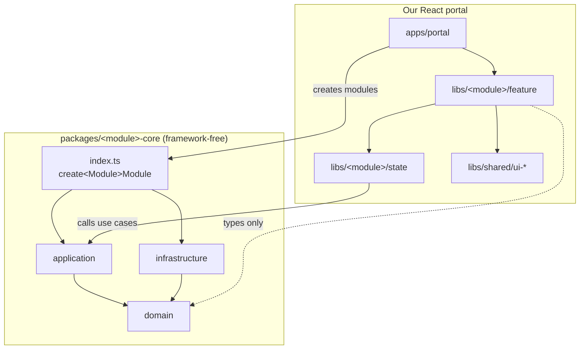
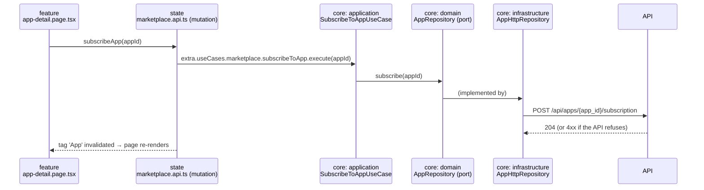

# 03 – Layers & libs

## In one minute

The code lives on **two levels**:

1. **Core packages** (`packages/<module>-core`) – framework-free TypeScript, one per backend module. They describe *what the data looks like* and *what a user can do*, and they orchestrate the API calls. Business decisions stay in the backend. Because they are framework-free, the UI on top is replaceable. Details: [04 – Core packages](./04-core-packages.md).
2. **Our React apps** (`apps/portal`, `apps/registration` + `libs/<module>/*`) – consumers of the core packages. It adds *what the app remembers* (Redux) and *what the user sees* (React).

Each module (e.g. `marketplace`) therefore has five parts. Each part answers exactly one question:

| Part | Where | The question it answers | Framework? | HTTP? |
|------|-------|-------------------------|:----------:|:-----:|
| `domain` | `packages/marketplace-core/src/domain` | **What** is an app, and which rules apply? | none | no |
| `application` | `packages/marketplace-core/src/application` | **What can a user do?** (one use case per operation, reads included) | none | no |
| `infrastructure` | `packages/marketplace-core/src/infrastructure` | **How** do we talk to the API? (generated client, mappers) | none | **yes** |
| `state` | `libs/marketplace/state` | **What does our app remember** right now? (Redux) | Redux | no |
| `feature` | `libs/marketplace/feature` | **What does the user see?** (pages) | React | no |

Plus shared parts:

- `packages/core-http`, `packages/core-kernel` – shared by all core packages.
- `libs/shared/*` – shared by our React app (MUI wrappers, layout, i18n, store setup, runtime config).
- `apps/portal`, `apps/registration` – start everything: create the core modules, the store, the router.

**The one rule to remember:** code may only import what is **further down** in this picture. Lint enforces it.



---

## Where does my code go?

| You are writing… | Put it in | Example file |
|------------------|-----------|--------------|
| The shape of a business object | `packages/<module>-core/src/domain/anemics/` | `app.anemic.ts` |
| A typed ID or validated value | type in `domain/valueObjects/`, creation in `domain/factories/` | `app-id.value-object.ts`, `app-id.factory.ts` |
| Code that builds a business object from raw values | `domain/factories/` | `app.factory.ts` |
| A UX pre-check that the API enforces again | `domain/domains/` | `registration-validation.domain.ts` |
| The interface for loading/saving data (port) | `domain/repositories/` | `app.repository.ts` |
| Inputs, results, filters (several interfaces per file allowed) | `domain/data/` | `app-filter.data.ts` |
| Any operation a UI may trigger, reads included | `application/useCases/` | `list-active-apps.use-case.ts` |
| Generated API types | `src/generated/` (never by hand) | `marketplace-api.d.ts` |
| DTO aliases, client type | `infrastructure/data/` | `marketplace-infrastructure.data.ts` |
| Converting `snake_case` DTOs to `camelCase` anemics | `infrastructure/mappers/` | `app.mapper.ts` |
| The implementation of a port | `infrastructure/repositories/` | `app-http.repository.ts` |
| The public module factory | `src/index.ts` | `createMarketplaceModule` |
| A value object several modules need | `packages/core-kernel` | `permission-key.value-object.ts` |
| RTK Query endpoints calling use cases | `libs/<module>/state/src/<module>.api.ts` | `marketplace.api.ts` |
| UI state that is not server data | `libs/<module>/state/src/slices/` | `app-filter.slice.ts` |
| Combining data for display | `libs/<module>/state/src/selectors/` | `select-filtered-apps.selector.ts` |
| A long-running use case with progress | `libs/<module>/state/src/thunks/` | `register-company.thunk.ts` |
| A page or container | `libs/<module>/feature/src/pages/`, `containers/` | `marketplace.page.tsx` |
| A reusable visual component | `libs/shared/ui-mui` or `libs/shared/ui-*` | `app-card.tsx` |

Still unsure? Ask: *"Would a different UI need this too?"* → core package. *"Is it a business decision?"* → backend, not frontend. *"Does it need React or Redux?"* → `libs/`. *"Is it a rule or a shape?"* → `domain`. *"Is it a user action?"* → `application`.

---

## One action, traced through all five parts

**Story:** the user clicks "Subscribe" on an app in the marketplace.



What each file does, in plain words:

1. **`libs/marketplace/feature/src/pages/app-detail.page.tsx`** shows the app (`useAppByIdQuery`). The button is enabled when the API says so (`app.canSubscribe`). On click it calls the `subscribeApp` mutation. No rules, no HTTP.
2. **`libs/marketplace/state/src/marketplace.api.ts`** defines that mutation. Its `queryFn` calls the use case from the container and invalidates the cache.
3. **`packages/marketplace-core/src/application/useCases/subscribe-to-app.use-case.ts`** calls the port. It does not decide whether subscribing is allowed – the API does.
4. **`…/domain/repositories/app.repository.ts`** is the port: `subscribe`.
5. **`…/infrastructure/repositories/app-http.repository.ts`** implements the port with the generated client; **`mappers/app.mapper.ts`** turns the API's `can_subscribe` into `canSubscribe` when the app is loaded.
6. **`apps/portal/src/container.ts`** creates the module once: `createMarketplaceModule(moduleConfig)`.

Another UI (e.g. Angular) would replace steps 1 and 2 with its own component and service. Steps 3–5 stay exactly the same.

---

## Core package reference: `@portal/marketplace-core`

```text
packages/marketplace-core/src/
  generated/marketplace-api.d.ts
  data/marketplace-module.data.ts
  domain/
    anemics/        app.anemic.ts
    valueObjects/   app-id.value-object.ts
    factories/      app.factory.ts, app-id.factory.ts
    repositories/   app.repository.ts
    events/         app-subscribed.event.ts
    data/           app-create.data.ts, app-filter.data.ts
    testing/        in-memory-app.repository.ts
  application/useCases/
                    list-active-apps.use-case.ts, get-app.use-case.ts, subscribe-to-app.use-case.ts
  infrastructure/
    data/           marketplace-infrastructure.data.ts
    mappers/        app.mapper.ts
    repositories/   app-http.repository.ts
  mocks/            marketplace.handlers.ts
  index.ts          # createMarketplaceModule + public exports
  testing.ts        # @portal/marketplace-core/testing
  mocks.ts          # @portal/marketplace-core/mocks
```

### Domain

```ts
// domain/valueObjects/app-id.value-object.ts
export type AppId = string & { readonly __brand: 'AppId' };
```

```ts
// domain/factories/app-id.factory.ts
import type { AppId } from '../valueObjects/app-id.value-object';

export class AppIdFactory {
  public static create(value: string): AppId {
    if (value.trim().length === 0) {
      throw new Error('AppId must not be empty');
    }
    return value as AppId;
  }
}
```

```ts
// domain/anemics/app.anemic.ts
import type { AppId } from '../valueObjects/app-id.value-object';

export type AppAnemic = Readonly<{
  id: AppId;
  name: string;
  provider: string;
  useCases: ReadonlyArray<string>;
  leadPictureUrl: string | null;
  isSubscribed: boolean;
  canSubscribe: boolean;
}>;
```

```ts
// domain/data/app-create.data.ts
export interface AppCreateData {
  id: string;
  name: string;
  provider: string;
  useCases?: ReadonlyArray<string>;
  leadPictureUrl?: string | null;
  isSubscribed?: boolean;
  canSubscribe?: boolean;
}
```

```ts
// domain/factories/app.factory.ts
import type { AppAnemic } from '../anemics/app.anemic';
import type { AppCreateData } from '../data/app-create.data';
import { AppIdFactory } from './app-id.factory';

export class AppFactory {
  public static create(input: AppCreateData): AppAnemic {
    return {
      id: AppIdFactory.create(input.id),
      name: input.name,
      provider: input.provider,
      useCases: input.useCases ?? [],
      leadPictureUrl: input.leadPictureUrl ?? null,
      isSubscribed: input.isSubscribed ?? false,
      canSubscribe: input.canSubscribe ?? false,
    };
  }
}
```

There is **no domain service** in this module. Whether an app can be subscribed is a business decision, so the API returns it as a flag (`can_subscribe`) and the frontend only shows it. `domain/domains/` is reserved for UX pre-checks the API enforces again, e.g. `RegistrationValidationDomain` ([04](./04-core-packages.md)).

```ts
// domain/repositories/app.repository.ts
import type { AppAnemic } from '../anemics/app.anemic';
import type { AppId } from '../valueObjects/app-id.value-object';

export interface AppRepository {
  findActive(): Promise<ReadonlyArray<AppAnemic>>;
  findById(id: AppId): Promise<AppAnemic | null>;
  subscribe(id: AppId): Promise<void>;
}
```

```ts
// domain/data/app-filter.data.ts
export interface AppFilter {
  search: string;
  useCase: string | null;
}

export interface AppSort {
  field: 'name' | 'provider';
  direction: 'asc' | 'desc';
}
```

### Application

Every operation a UI may trigger is a use case, also simple reads. That way no UI ever has to know the HTTP client. Most use cases are thin: they call the port and return plain data. Ordering several calls (like registration) is the main reason for more code here.

```ts
// application/useCases/list-active-apps.use-case.ts
import type { AppAnemic } from '../../domain/anemics/app.anemic';
import type { AppRepository } from '../../domain/repositories/app.repository';

export class ListActiveAppsUseCase {
  constructor(private readonly apps: AppRepository) {}

  public execute(): Promise<ReadonlyArray<AppAnemic>> {
    return this.apps.findActive();
  }
}
```

```ts
// application/useCases/get-app.use-case.ts
import type { AppAnemic } from '../../domain/anemics/app.anemic';
import type { AppRepository } from '../../domain/repositories/app.repository';
import type { AppId } from '../../domain/valueObjects/app-id.value-object';

export class GetAppUseCase {
  constructor(private readonly apps: AppRepository) {}

  public execute(id: AppId): Promise<AppAnemic | null> {
    return this.apps.findById(id);
  }
}
```

```ts
// application/useCases/subscribe-to-app.use-case.ts
import type { AppRepository } from '../../domain/repositories/app.repository';
import type { AppId } from '../../domain/valueObjects/app-id.value-object';

export class SubscribeToAppUseCase {
  constructor(private readonly apps: AppRepository) {}

  public execute(id: AppId): Promise<void> {
    return this.apps.subscribe(id);
  }
}
```

### Infrastructure

```ts
// infrastructure/data/marketplace-infrastructure.data.ts
import type { Client } from 'openapi-fetch';
import type { components, paths } from '../../generated/marketplace-api';

export type MarketplaceClient = Client<paths>;
export type AppDto = components['schemas']['AppResponse'];
```

```ts
// infrastructure/mappers/app.mapper.ts
import type { AppAnemic } from '../../domain/anemics/app.anemic';
import { AppFactory } from '../../domain/factories/app.factory';
import type { AppDto } from '../data/marketplace-infrastructure.data';

export class AppMapper {
  public static toAnemic(dto: AppDto): AppAnemic {
    return AppFactory.create({
      id: dto.app_id,
      name: dto.name,
      provider: dto.provider,
      useCases: dto.use_cases,
      leadPictureUrl: dto.lead_picture_url,
      isSubscribed: dto.is_subscribed,
      canSubscribe: dto.can_subscribe,
    });
  }
}
```

```ts
// infrastructure/repositories/app-http.repository.ts
import { CoreHttpException, ensureData, ensureOk, HTTP } from '@portal/core-http';
import type { AppAnemic } from '../../domain/anemics/app.anemic';
import type { AppRepository } from '../../domain/repositories/app.repository';
import type { AppId } from '../../domain/valueObjects/app-id.value-object';
import type { MarketplaceClient } from '../data/marketplace-infrastructure.data';
import { AppMapper } from '../mappers/app.mapper';

export class AppHttpRepository implements AppRepository {
  constructor(private readonly client: MarketplaceClient) {}

  public async findActive(): Promise<ReadonlyArray<AppAnemic>> {
    const dtos = await ensureData(this.client.GET('/api/apps/active'));
    return dtos.map((dto) => AppMapper.toAnemic(dto));
  }

  public async findById(id: AppId): Promise<AppAnemic | null> {
    try {
      const dto = await ensureData(this.client.GET('/api/apps/{app_id}', { params: { path: { app_id: id } } }));
      return AppMapper.toAnemic(dto);
    } catch (error) {
      if (error instanceof CoreHttpException && error.status === HTTP.NOT_FOUND) {
        return null;
      }
      throw error;
    }
  }

  public subscribe(id: AppId): Promise<void> {
    return ensureOk(this.client.POST('/api/apps/{app_id}/subscription', { params: { path: { app_id: id } } }));
  }
}
```

### Public API

```ts
// data/marketplace-module.data.ts
import type { GetAppUseCase } from '../application/useCases/get-app.use-case';
import type { ListActiveAppsUseCase } from '../application/useCases/list-active-apps.use-case';
import type { SubscribeToAppUseCase } from '../application/useCases/subscribe-to-app.use-case';

export interface MarketplaceModule {
  listActiveApps: ListActiveAppsUseCase;
  getApp: GetAppUseCase;
  subscribeToApp: SubscribeToAppUseCase;
}
```

```ts
// index.ts
import { createCoreClient, type CoreModuleConfig } from '@portal/core-http';
import { GetAppUseCase } from './application/useCases/get-app.use-case';
import { ListActiveAppsUseCase } from './application/useCases/list-active-apps.use-case';
import { SubscribeToAppUseCase } from './application/useCases/subscribe-to-app.use-case';
import type { MarketplaceModule } from './data/marketplace-module.data';
import type { paths } from './generated/marketplace-api';
import { AppHttpRepository } from './infrastructure/repositories/app-http.repository';

export function createMarketplaceModule(config: CoreModuleConfig): MarketplaceModule {
  const apps = new AppHttpRepository(createCoreClient<paths>(config));
  return {
    listActiveApps: new ListActiveAppsUseCase(apps),
    getApp: new GetAppUseCase(apps),
    subscribeToApp: new SubscribeToAppUseCase(apps),
  };
}

export type { MarketplaceModule } from './data/marketplace-module.data';
export type { AppAnemic } from './domain/anemics/app.anemic';
export type { AppFilter, AppSort } from './domain/data/app-filter.data';
export type { AppRepository } from './domain/repositories/app.repository';
export type { AppId } from './domain/valueObjects/app-id.value-object';
export { AppIdFactory } from './domain/factories/app-id.factory';
```

---

## React portal reference: `libs/marketplace/*`

```text
libs/marketplace/state/src/
  data/marketplace-use-cases.data.ts     # registers MarketplaceModule in the use case registry
  marketplace.api.ts                     # RTK Query endpoints with queryFn → use cases
  slices/app-filter.slice.ts, app-filter.initial-state.ts
  selectors/select-filtered-apps.selector.ts
  hooks.ts                               # re-exports the endpoint hooks
  index.ts

libs/marketplace/feature/src/
  pages/marketplace.page.tsx, app-detail.page.tsx
  containers/app-list.container.tsx
  locale/de/*.json, locale/en/*.json
  marketplace.pages.ts                   # page definitions
  marketplace.components.ts              # lazy page components
  index.ts
```

Code for the state lib: [06 – Data flow](./06-data-flow-redux.md).

- Slices hold **UI state only**; server data stays in the RTK Query cache.
- Pages call hooks from `state` and render `ui` components. No business decisions in JSX, no `@mui/*`.

---

## Who may import whom

| Part | May import | Must not import |
|------|-----------|-----------------|
| `apps/*` | everything | – |
| `libs/<module>/feature` | `feature`, `state`, `libs/shared/ui-*`, core packages (**types and value object factories only**), `util` | core `index` factories, `openapi-fetch` |
| `libs/shared/ui-*` | `ui`, `util` | anything with business meaning |
| `libs/<module>/state` | `state`, `libs/shared/state-core`, core packages | `feature`, `ui` |
| core `src/index.ts` | everything inside its package, `@portal/core-*` | anything in `libs/` or `apps/` |
| core `application` | own `domain`, `@portal/core-kernel` | own `infrastructure`, `openapi-fetch`, any framework |
| core `infrastructure` | own `domain`, own `generated`, `@portal/core-http`, `@portal/core-kernel` | own `application` |
| core `domain` | own `domain`, `@portal/core-kernel` | everything else |
| `@portal/core-http` | `@portal/core-kernel`, `openapi-fetch` | any module core package |

Between modules: a core package never imports another module's core package. A concept two modules need goes into `@portal/core-kernel`. Cross-module reactions happen in the UI layer (for us: RTK listener middleware, see [06](./06-data-flow-redux.md#cross-module-reactions)).

---

## Common mistakes

| Mistake | Why it is wrong | Do instead |
|---------|-----------------|------------|
| A page calls `createMarketplaceModule` or the client | Bypasses the container and the cache | Use the hook from `@portal/marketplace-state` |
| React or Redux imported in a core package | Breaks Angular/Vue consumers | Keep it in `libs/<module>/state` or `feature` |
| `if (app.useCases.length > 0)` to decide whether an action is allowed | Business decision in the frontend | Use the flag the API returns (`app.canSubscribe`); ask the API team if it is missing |
| `fetchBaseQuery` with a handwritten URL in `state` | Duplicates the core adapter and mapper | `queryFn` that calls the use case |
| Using `use_cases` in a component | DTO leaked out of the core package | Map to `useCases` in the mapper |
| Editing `src/generated/*` | Overwritten by the next generator run | Change the spec, regenerate |
| A type and its factory in one file | Breaks one-type-per-file | Type in `valueObjects/`, creation in `factories/` |
