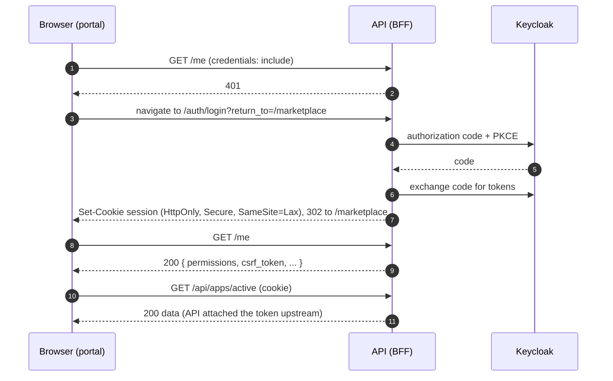

# 04 – Auth & session

## Why there is no Keycloak in the frontend

The legacy portal used `keycloak-js` in the browser: it held access tokens, refreshed them, decoded roles per client ID and attached `Bearer` headers to calls against five backends. That spread security logic across 36+ RTK Query APIs.

The new API is a **backend-for-frontend (BFF)**: it runs the OIDC code flow with Keycloak, keeps access and refresh tokens server-side and gives the browser only an **HttpOnly session cookie**. The frontend never sees a token.

## Contract the frontend expects

The API team owns the implementation. The frontend needs these endpoints (fields in `snake_case`):

| Endpoint | Purpose | Response |
|----------|---------|----------|
| `GET /auth/login?return_to=<path>` | Starts authorization code + PKCE with Keycloak | 302 to Keycloak; the callback sets the cookie and redirects to `return_to` |
| `POST /auth/logout` | Ends the session and the Keycloak session | 204 or 302 to a logout page |
| `GET /me` | Current user and permissions | `{ id, name, username, company, permissions: string[], csrf_token }` or 401 |
| `GET /config` | Branding, feature flags, languages | `{ logo_url, features: Record<string, boolean>, languages: string[] }` |
| `/api/**` | All business calls, including BPDM, semantics, MIW, SSI | The API proxies/aggregates and attaches tokens |

Agree the exact names in the OpenAPI spec in phase 0 and generate the DTOs from it.

## Login flow



## Session handling in the frontend

1. **Bootstrap.** Before the router renders, `SessionGate` dispatches `getCurrentSession`. While pending it shows the app loader.
2. **401 on `/me`** → `RedirectPort.toLogin(currentPath)` sets `window.location` to `/auth/login?return_to=…`. There is no login screen in the frontend.
3. **200 on `/me`** → the session (user + permissions) lands in the `session` slice. The CSRF token is stored in memory inside `shared/infrastructure-http`, never in Redux or storage.
4. **Any later 401** from any request → the base query triggers the same redirect centrally. Token refresh is invisible: the API does it.
5. **Logout** → `POST /auth/logout`, then redirect to the URL the API returns (or `/`).

## Cross-origin setup

The API runs on its own domain (e.g. `api.portal.example.org`), the frontend on `portal.example.org`.

| Topic | Requirement |
|-------|-------------|
| CORS | `Access-Control-Allow-Origin` = the exact frontend origin, never `*`; `Access-Control-Allow-Credentials: true` |
| Requests | Every request uses `credentials: 'include'` (set once in the base query) |
| Cookie | `HttpOnly; Secure; SameSite=Lax`, which works because both hosts share the registrable domain `example.org` (same-site) |
| Different main domains | Would need `SameSite=None` and run into third-party cookie blocking. Treat "same main domain" as a hard requirement for operations |
| CSRF | Write requests send `X-CSRF-Token` with the token from `/me`. The API validates it |
| API URL | Comes from `/config.json` at runtime (see [06](./06-runtime-config-and-deployment.md)) |

## The identity context

```text
libs/identity/
  domain/src/
    anemics/          user.anemic.ts, session.anemic.ts
    domains/          has-permission.domain.ts
    repositories/     session.repository.ts, redirect.port.ts
    factories/        session.factory.ts, user.factory.ts
  application/src/useCases/
                      get-current-session.use-case.ts
                      login.use-case.ts
                      logout.use-case.ts
  infrastructure/src/
    data/             session.data.ts          # MeResponseDto (snake_case)
    mappers/          session.mapper.ts
    repositories/     session-rtk.repository.ts
    adapters/         browser-redirect.adapter.ts
    identity.api.ts                            # endpoints: me, logout
  state/src/
    slices/           session.slice.ts
    selectors/        select-has-permission.selector.ts
    thunks/           bootstrap-session.thunk.ts, logout.thunk.ts
  feature/src/
    session-gate.tsx
    require-access.tsx
    user-menu.container.tsx
```

### Ports

```ts
// domain/src/repositories/session.repository.ts
import type { SessionAnemic } from '../anemics/session.anemic';

export interface SessionRepository {
  getCurrent(): Promise<SessionAnemic | null>;   // null = not logged in (401)
  logout(): Promise<string | null>;              // optional redirect URL
}
```

```ts
// domain/src/repositories/redirect.port.ts
export interface RedirectPort {
  toLogin(returnTo: string): void;
  to(url: string): void;
}
```

### Use case

```ts
// application/src/useCases/get-current-session.use-case.ts
import type { RedirectPort, SessionAnemic, SessionRepository } from '@portal/identity-domain';

export class GetCurrentSessionUseCase {
  constructor(
    private readonly sessions: SessionRepository,
    private readonly redirect: RedirectPort,
  ) {}

  public async execute(currentPath: string): Promise<SessionAnemic | null> {
    const session = await this.sessions.getCurrent();
    if (session === null) {
      this.redirect.toLogin(currentPath);
      return null;
    }
    return session;
  }
}
```

### Permissions

- Permission keys are business strings like `apps.view`, `services.view`, `semantichub.view`, `users.manage`.
- The mapping from the old Keycloak roles (`ROLES` in `types/Constants.ts` of `portal-frontend`, checked per client ID in `services/AccessService.tsx`) to keys is done **once** in phase 0 and lives in the API.
- The frontend checks keys with `HasPermissionDomain.check(session, key)` and the selector `selectHasPermission(key)`.

## What is not carried over from the legacy `portal-frontend`

- `keycloak-js` and `services/UserService.ts` (Keycloak init with `login-required`, token refresh, `getToken`, `getAccess`, `getParsedToken`)
- The `Bearer ${UserService.getToken()}` headers in `utils/rtkUtil.ts` (`apiBaseQuery`, `apiSsiCredentialQuery` and the BPDM/MIW variants)
- The client-role checks in `services/AccessService.tsx` (`userHasPortalRole`, `userHasRegistrationRole`, `userHasSemanticHubRole`, `userHasBpdmRole`, `userHasMiwRole`, `userHasSsiCredentialRole`)
- From `services/EnvironmentService.ts`: central IdP URL, realm, all client IDs, and the separate backend URLs for BPDM pool/gate, semantics, MIW and SSI
- `KeycloakResourceAccess` as a type anywhere in the code
