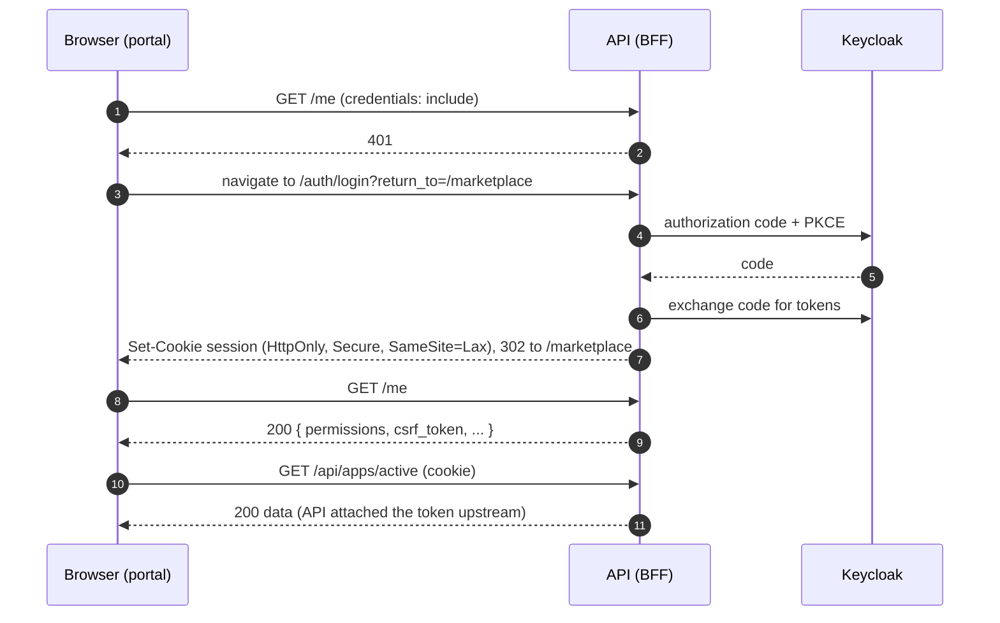

# 05 – Auth & session

## Why there is no Keycloak in the frontend

The legacy portal used `keycloak-js` in the browser: it held access tokens, refreshed them, decoded roles per client ID and attached `Bearer` headers to calls against five backends. That spread security logic across 36+ RTK Query APIs.

The new API is a **backend-for-frontend (BFF)**: it runs the OIDC code flow with Keycloak, keeps access and refresh tokens server-side and gives the browser only an **HttpOnly session cookie**. The frontend never sees a token.

## Contract the frontend expects

The API team owns the implementation. The frontend needs these endpoints (fields in `snake_case`):

| Endpoint | Purpose | Response |
|----------|---------|----------|
| `GET /auth/login?return_to=<path>` | Starts authorization code + PKCE with Keycloak | 302 to Keycloak; the callback sets the cookie and redirects to `return_to` |
| `POST /auth/logout` | Ends the session and the Keycloak session | 204 or 302 to a logout page |
| `GET /me` | Current user and permissions | `{ id, name, username, company, permissions: string[], csrf_token }` or 401 |
| `GET /config` | Branding, feature flags, languages | `{ logo_url, features: Record<string, boolean>, languages: string[] }` |
| `/api/**` | All business calls, including BPDM, semantics, MIW, SSI | The API proxies/aggregates and attaches tokens |

Agree the exact names in the OpenAPI spec in phase 0 and generate the DTOs from it.

## Login flow



## Session handling in the frontend

1. **Bootstrap.** Before the router renders, `SessionGate` runs the `currentSession` query. While it is pending, it shows the app loader.
2. **401 on `/me`** → the `GetCurrentSessionUseCase` calls `RedirectPort.toLogin(currentPath)`, which sets `window.location` to `/auth/login?return_to=…`. There is no login screen in the frontend.
3. **200 on `/me`** → the use case stores the CSRF token in memory (`CsrfTokenStore` from `@portal/core-http`) and returns the session. In our React portal the session lives in the RTK Query cache.
4. **Any later 401** from any other module → `onUnauthorized` in the core config calls `LoginUseCase`, which triggers the same redirect. Token refresh is invisible: the API does it.
5. **Logout** → `LogoutUseCase`: `POST /auth/logout`, clear the CSRF token, redirect to the URL the API returns (or `/`).

Steps 1–5 work the same in both apps (and in any other UI), because all of it lives in `@portal/identity-core`.

## Cross-origin setup

The API runs on its own domain (e.g. `api.portal.example.org`), the frontend on `portal.example.org`.

| Topic | Requirement |
|-------|-------------|
| CORS | `Access-Control-Allow-Origin` = the exact frontend origin, never `*`; `Access-Control-Allow-Credentials: true` |
| Requests | Every request uses `credentials: 'include'` (set once in `createCoreClient`) |
| Cookie | `HttpOnly; Secure; SameSite=Lax`, which works because both hosts share the registrable domain `example.org` (same-site) |
| Different main domains | Would need `SameSite=None` and run into third-party cookie blocking. Treat "same main domain" as a hard requirement for operations |
| CSRF | Write requests send `X-CSRF-Token` with the token from `/me`. The API validates it |
| API URL | Comes from `/config.json` at runtime (see [07](./07-runtime-config-and-deployment.md)) |

## `@portal/identity-core`

```text
packages/identity-core/src/
  generated/identity-api.d.ts
  data/identity-module.data.ts
  domain/
    anemics/        user.anemic.ts, session.anemic.ts
    domains/        has-permission.domain.ts
    repositories/   session.repository.ts, redirect.port.ts, csrf-token.port.ts
  application/useCases/
                    get-current-session.use-case.ts, login.use-case.ts, logout.use-case.ts
  infrastructure/
    constants/      auth-path.constant.ts
    data/           identity-infrastructure.data.ts
    mappers/        session.mapper.ts
    repositories/   session-http.repository.ts
    adapters/       browser-redirect.adapter.ts, csrf-token.adapter.ts
  index.ts
```

### Domain

```ts
// domain/anemics/user.anemic.ts
export type UserAnemic = Readonly<{
  id: string;
  name: string;
  username: string;
  company: string;
}>;
```

```ts
// domain/anemics/session.anemic.ts
import type { PermissionKey } from '@portal/core-kernel';
import type { UserAnemic } from './user.anemic';

export type SessionAnemic = Readonly<{
  user: UserAnemic;
  permissions: ReadonlyArray<PermissionKey>;
  csrfToken: string;
}>;
```

```ts
// domain/repositories/session.repository.ts
import type { SessionAnemic } from '../anemics/session.anemic';

export interface SessionRepository {
  /** null = not logged in (401) */
  getCurrent(): Promise<SessionAnemic | null>;
  /** optional URL to redirect to after logout */
  logout(): Promise<string | null>;
}
```

```ts
// domain/repositories/redirect.port.ts
export interface RedirectPort {
  toLogin(returnTo: string): void;
  to(url: string): void;
}
```

```ts
// domain/repositories/csrf-token.port.ts
export interface CsrfTokenPort {
  set(token: string | null): void;
}
```

```ts
// domain/domains/has-permission.domain.ts
import type { PermissionKey } from '@portal/core-kernel';
import type { SessionAnemic } from '../anemics/session.anemic';

export class HasPermissionDomain {
  public static check(session: SessionAnemic | null | undefined, permission: PermissionKey | undefined): boolean {
    if (session === null || session === undefined) {
      return false;
    }
    if (permission === undefined) {
      return true;
    }
    return session.permissions.includes(permission);
  }
}
```

### Application

```ts
// application/useCases/get-current-session.use-case.ts
import type { SessionAnemic } from '../../domain/anemics/session.anemic';
import type { CsrfTokenPort } from '../../domain/repositories/csrf-token.port';
import type { RedirectPort } from '../../domain/repositories/redirect.port';
import type { SessionRepository } from '../../domain/repositories/session.repository';

export class GetCurrentSessionUseCase {
  constructor(
    private readonly sessions: SessionRepository,
    private readonly redirect: RedirectPort,
    private readonly csrf: CsrfTokenPort,
  ) {}

  public async execute(currentPath: string): Promise<SessionAnemic | null> {
    const session = await this.sessions.getCurrent();
    if (session === null) {
      this.redirect.toLogin(currentPath);
      return null;
    }
    this.csrf.set(session.csrfToken);
    return session;
  }
}
```

```ts
// application/useCases/login.use-case.ts
import type { RedirectPort } from '../../domain/repositories/redirect.port';

export class LoginUseCase {
  constructor(private readonly redirect: RedirectPort) {}

  public execute(returnTo: string): void {
    this.redirect.toLogin(returnTo);
  }
}
```

```ts
// application/useCases/logout.use-case.ts
import type { CsrfTokenPort } from '../../domain/repositories/csrf-token.port';
import type { RedirectPort } from '../../domain/repositories/redirect.port';
import type { SessionRepository } from '../../domain/repositories/session.repository';

export class LogoutUseCase {
  constructor(
    private readonly sessions: SessionRepository,
    private readonly redirect: RedirectPort,
    private readonly csrf: CsrfTokenPort,
  ) {}

  public async execute(): Promise<void> {
    const redirectUrl = await this.sessions.logout();
    this.csrf.set(null);
    this.redirect.to(redirectUrl ?? '/');
  }
}
```

### Infrastructure

```ts
// infrastructure/constants/auth-path.constant.ts
export const AUTH_PATH = {
  LOGIN: '/auth/login',
  RETURN_TO_PARAM: 'return_to',
} as const;
```

```ts
// infrastructure/data/identity-infrastructure.data.ts
import type { Client } from 'openapi-fetch';
import type { components, paths } from '../../generated/identity-api';

export type IdentityClient = Client<paths>;
export type MeResponseDto = components['schemas']['MeResponse'];
```

```ts
// infrastructure/mappers/session.mapper.ts
import { PermissionKeyFactory } from '@portal/core-kernel';
import type { SessionAnemic } from '../../domain/anemics/session.anemic';
import type { MeResponseDto } from '../data/identity-infrastructure.data';

export class SessionMapper {
  public static toAnemic(dto: MeResponseDto): SessionAnemic {
    return {
      user: {
        id: dto.id,
        name: dto.name,
        username: dto.username,
        company: dto.company,
      },
      permissions: dto.permissions.map((permission) => PermissionKeyFactory.create(permission)),
      csrfToken: dto.csrf_token,
    };
  }
}
```

```ts
// infrastructure/repositories/session-http.repository.ts
import { CoreHttpException, ensureData, HTTP } from '@portal/core-http';
import type { SessionAnemic } from '../../domain/anemics/session.anemic';
import type { SessionRepository } from '../../domain/repositories/session.repository';
import type { IdentityClient } from '../data/identity-infrastructure.data';
import { SessionMapper } from '../mappers/session.mapper';

export class SessionHttpRepository implements SessionRepository {
  constructor(private readonly client: IdentityClient) {}

  public async getCurrent(): Promise<SessionAnemic | null> {
    try {
      const dto = await ensureData(this.client.GET('/me'));
      return SessionMapper.toAnemic(dto);
    } catch (error) {
      if (error instanceof CoreHttpException && error.status === HTTP.UNAUTHORIZED) {
        return null;
      }
      throw error;
    }
  }

  public async logout(): Promise<string | null> {
    const dto = await ensureData(this.client.POST('/auth/logout'));
    return dto?.redirect_url ?? null;
  }
}
```

```ts
// infrastructure/adapters/browser-redirect.adapter.ts
import type { RedirectPort } from '../../domain/repositories/redirect.port';
import { AUTH_PATH } from '../constants/auth-path.constant';

export class BrowserRedirectAdapter implements RedirectPort {
  constructor(private readonly baseUrl: string) {}

  public toLogin(returnTo: string): void {
    const url = new URL(AUTH_PATH.LOGIN, this.baseUrl);
    url.searchParams.set(AUTH_PATH.RETURN_TO_PARAM, returnTo);
    this.to(url.toString());
  }

  public to(url: string): void {
    window.location.assign(url);
  }
}
```

```ts
// infrastructure/adapters/csrf-token.adapter.ts
import { CsrfTokenStore } from '@portal/core-http';
import type { CsrfTokenPort } from '../../domain/repositories/csrf-token.port';

export class CsrfTokenAdapter implements CsrfTokenPort {
  public set(token: string | null): void {
    CsrfTokenStore.set(token);
  }
}
```

### Public API

```ts
// data/identity-module.data.ts
import type { GetCurrentSessionUseCase } from '../application/useCases/get-current-session.use-case';
import type { LoginUseCase } from '../application/useCases/login.use-case';
import type { LogoutUseCase } from '../application/useCases/logout.use-case';

export interface IdentityModule {
  getCurrentSession: GetCurrentSessionUseCase;
  login: LoginUseCase;
  logout: LogoutUseCase;
}
```

```ts
// index.ts
import { createCoreClient, type CoreModuleConfig } from '@portal/core-http';
import { GetCurrentSessionUseCase } from './application/useCases/get-current-session.use-case';
import { LoginUseCase } from './application/useCases/login.use-case';
import { LogoutUseCase } from './application/useCases/logout.use-case';
import type { IdentityModule } from './data/identity-module.data';
import type { paths } from './generated/identity-api';
import { BrowserRedirectAdapter } from './infrastructure/adapters/browser-redirect.adapter';
import { CsrfTokenAdapter } from './infrastructure/adapters/csrf-token.adapter';
import { SessionHttpRepository } from './infrastructure/repositories/session-http.repository';

export function createIdentityModule(config: CoreModuleConfig): IdentityModule {
  const sessions = new SessionHttpRepository(createCoreClient<paths>(config));
  const redirect = new BrowserRedirectAdapter(config.baseUrl);
  const csrf = new CsrfTokenAdapter();
  return {
    getCurrentSession: new GetCurrentSessionUseCase(sessions, redirect, csrf),
    login: new LoginUseCase(redirect),
    logout: new LogoutUseCase(sessions, redirect, csrf),
  };
}

export type { IdentityModule } from './data/identity-module.data';
export type { SessionAnemic } from './domain/anemics/session.anemic';
export type { UserAnemic } from './domain/anemics/user.anemic';
export { HasPermissionDomain } from './domain/domains/has-permission.domain';
```

## Our React side: `libs/identity/state` and `libs/identity/feature`

```ts
// libs/identity/state/src/data/identity-use-cases.data.ts
import type { IdentityModule } from '@portal/identity-core';

declare module '@portal/shared-state-core' {
  interface UseCaseRegistry {
    identity: IdentityModule;
  }
}
```

```ts
// libs/identity/state/src/identity.api.ts
import type { SessionAnemic } from '@portal/identity-core';
import { getUseCases, portalApi, toQueryResult } from '@portal/shared-state-core';
import './data/identity-use-cases.data';

export const identityApi = portalApi.injectEndpoints({
  endpoints: (build) => ({
    currentSession: build.query<SessionAnemic | null, void>({
      queryFn: (_arg, api) =>
        toQueryResult(() => getUseCases(api).identity.getCurrentSession.execute(window.location.pathname)),
      providesTags: ['Session'],
    }),
    logout: build.mutation<void, void>({
      queryFn: (_arg, api) => toQueryResult(() => getUseCases(api).identity.logout.execute()),
      invalidatesTags: ['Session'],
    }),
  }),
});
```

```ts
// libs/identity/state/src/hooks.ts
import { identityApi } from './identity.api';

export const { useCurrentSessionQuery, useLogoutMutation } = identityApi;
```

```ts
// libs/identity/state/src/use-has-permission.hook.ts
import type { PermissionKey } from '@portal/core-kernel';
import { HasPermissionDomain } from '@portal/identity-core';
import { useCurrentSessionQuery } from './hooks';

export function useHasPermission(permission: PermissionKey | undefined): boolean {
  const { data: session } = useCurrentSessionQuery();
  return HasPermissionDomain.check(session, permission);
}
```

```tsx
// libs/identity/feature/src/session-gate.tsx
import type { PropsWithChildren } from 'react';
import { useCurrentSessionQuery } from '@portal/identity-state';
import { PageLoader, QueryError } from '@portal/shared-ui-feedback';

export function SessionGate({ children }: PropsWithChildren) {
  const { data: session, error, isLoading } = useCurrentSessionQuery();
  if (isLoading || session === null) {
    return <PageLoader />;
  }
  if (error !== undefined || session === undefined) {
    return <QueryError error={error} />;
  }
  return children;
}
```

`session === null` means the redirect to login is already under way, so the loader stays visible.

## Permissions

- Permission keys are business strings like `apps.view`, `services.view`, `semantichub.view`, `users.manage` (`PermissionKey` from `@portal/core-kernel`).
- The mapping from the old Keycloak roles (`ROLES` in `types/Constants.ts` of `portal-frontend`, checked per client ID in `services/AccessService.tsx`) to keys is done **once** in phase 0 and lives in the API.
- Every UI checks keys with `HasPermissionDomain.check(session, key)`. Our React portal wraps it in `useHasPermission(key)`.

## What is not carried over from the legacy `portal-frontend`

- `keycloak-js` and `services/UserService.ts` (Keycloak init with `login-required`, token refresh, `getToken`, `getAccess`, `getParsedToken`)
- The `Bearer ${UserService.getToken()}` headers in `utils/rtkUtil.ts` (`apiBaseQuery`, `apiSsiCredentialQuery` and the BPDM/MIW variants)
- The client-role checks in `services/AccessService.tsx` (`userHasPortalRole`, `userHasRegistrationRole`, `userHasSemanticHubRole`, `userHasBpdmRole`, `userHasMiwRole`, `userHasSsiCredentialRole`)
- From `services/EnvironmentService.ts`: central IdP URL, realm, all client IDs, and the separate backend URLs for BPDM pool/gate, semantics, MIW and SSI
- `KeycloakResourceAccess` as a type anywhere in the code
