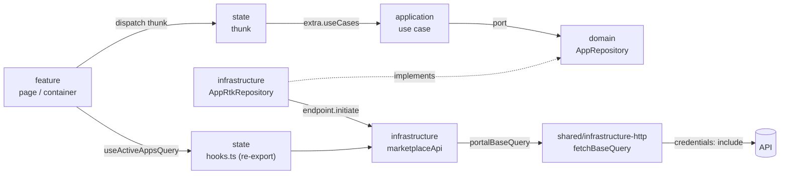

# 05 – Data flow & Redux Toolkit

## The big picture



Two paths, one cache:

- **Read without logic**: feature → hook from `state` → endpoint in `infrastructure` → API.
- **Operation with logic**: feature → thunk in `state` → use case → port → adapter → endpoint → API.

Both go through the same RTK Query endpoints, so they share cache, loading state and tag invalidation.

## Step 1 – Shared HTTP: base query and `portalApi`

`libs/shared/infrastructure-http` contains the single `createApi` of the app. Contexts never call `createApi` themselves.

```ts
// libs/shared/infrastructure-http/src/raw-base-query.ts
import { fetchBaseQuery } from '@reduxjs/toolkit/query';
import { ENV } from '@portal/shared-infrastructure-config';
import { CsrfStore } from './csrf/csrf.store';

export const rawBaseQuery = fetchBaseQuery({
  baseUrl: ENV.apiBaseUrl,
  credentials: 'include',
  prepareHeaders: (headers) => {
    const csrf = CsrfStore.get();
    if (csrf !== null) {
      headers.set('X-CSRF-Token', csrf);
    }
    return headers;
  },
});
```

```ts
// libs/shared/infrastructure-http/src/portal.base-query.ts
import type { BaseQueryFn, FetchArgs, FetchBaseQueryError } from '@reduxjs/toolkit/query';
import { LoginRedirect } from './redirect/login.redirect';
import { rawBaseQuery } from './raw-base-query';

export const portalBaseQuery: BaseQueryFn<string | FetchArgs, unknown, FetchBaseQueryError> = async (
  args,
  api,
  extraOptions,
) => {
  const result = await rawBaseQuery(args, api, extraOptions);
  if (result.error?.status === 401) {
    LoginRedirect.toLogin(window.location.pathname);
  }
  return result;
};
```

```ts
// libs/shared/infrastructure-http/src/portal.api.ts
import { createApi } from '@reduxjs/toolkit/query/react';
import { portalBaseQuery } from './portal.base-query';

export const portalApi = createApi({
  reducerPath: 'portalApi',
  baseQuery: portalBaseQuery,
  tagTypes: ['Session', 'App', 'Service', 'User', 'Company'],
  endpoints: () => ({}),
});
```

`ENV.apiBaseUrl` is read when the module is evaluated. That is safe because the app calls `await loadEnv()` before it imports the store (see [06](./06-runtime-config-and-deployment.md)).

**Variants.** If a context needs other headers or a timeout, pass them per endpoint (`query: () => ({ url, headers, timeout })`). Only if a whole area needs a different base (e.g. a path prefix), turn the base query into a factory `createBaseQuery(options)` in the same lib. Never copy it.

## Step 2 – DTOs (snake_case) and mappers

DTO types are generated from the OpenAPI spec into `infrastructure/src/data/generated/api.d.ts`. A small alias file gives them readable names.

```ts
// libs/marketplace/infrastructure/src/data/app.data.ts
import type { components } from './generated/api';

export type AppDto = components['schemas']['AppResponse'];
export type AppListDto = ReadonlyArray<AppDto>;
```

If the spec is not available yet, write the same shape by hand in that file and replace it later:

```ts
export interface AppDto {
  id: string;
  name: string;
  provider: string;
  use_cases: string[];
  lead_picture_url: string | null;
  is_subscribed: boolean;
}
```

The mapper is the only place where `snake_case` meets `camelCase`:

```ts
// libs/marketplace/infrastructure/src/mappers/app.mapper.ts
import { AppFactory, type AppAnemic } from '@portal/marketplace-domain';
import type { AppDto } from '../data/app.data';

export class AppMapper {
  public static toAnemic(dto: AppDto): AppAnemic {
    return AppFactory.create({
      id: dto.id,
      name: dto.name,
      provider: dto.provider,
      useCases: dto.use_cases,
      leadPictureUrl: dto.lead_picture_url,
      isSubscribed: dto.is_subscribed,
    });
  }
}
```

### Runtime validation with zod (optional per endpoint)

Use it where the API is new or unstable, or for data that drives permissions. Put schemas in `infrastructure/src/schemas/`.

```ts
// libs/marketplace/infrastructure/src/schemas/app.schema.ts
import { z } from 'zod';

export const appSchema = z.object({
  id: z.string().min(1),
  name: z.string(),
  provider: z.string(),
  use_cases: z.array(z.string()),
  lead_picture_url: z.string().nullable(),
  is_subscribed: z.boolean(),
});
```

In `transformResponse`: `appSchema.array().parse(raw).map(AppMapper.toAnemic)`. A failed parse surfaces as a query error, which is better than a broken component.

## Step 3 – Endpoints per context

```ts
// libs/marketplace/infrastructure/src/marketplace.api.ts
import { portalApi } from '@portal/shared-infrastructure-http';
import type { AppAnemic } from '@portal/marketplace-domain';
import type { AppDto, AppListDto } from './data/app.data';
import { AppMapper } from './mappers/app.mapper';

export const marketplaceApi = portalApi.injectEndpoints({
  endpoints: (build) => ({
    activeApps: build.query<ReadonlyArray<AppAnemic>, void>({
      query: () => 'apps/active',
      transformResponse: (dtos: AppListDto) => dtos.map((dto) => AppMapper.toAnemic(dto)),
      providesTags: ['App'],
    }),
    appById: build.query<AppAnemic, string>({
      query: (id) => `apps/${id}`,
      transformResponse: (dto: AppDto) => AppMapper.toAnemic(dto),
      providesTags: (_result, _error, id) => [{ type: 'App', id }],
    }),
    subscribeApp: build.mutation<void, string>({
      query: (id) => ({ url: `apps/${id}/subscription`, method: 'POST' }),
      invalidatesTags: (_result, _error, id) => ['App', { type: 'App', id }],
    }),
  }),
});
```

## Step 4 – Port adapters

Where a use case needs data, an adapter implements the domain port on top of the endpoints. `subscribe: false` avoids keeping a cache subscription open.

```ts
// libs/marketplace/infrastructure/src/repositories/app-rtk.repository.ts
import type { AppAnemic, AppId, AppRepository } from '@portal/marketplace-domain';
import type { PortalDispatch } from '@portal/shared-infrastructure-http';
import { marketplaceApi } from '../marketplace.api';

export class AppRtkRepository implements AppRepository {
  constructor(private readonly dispatch: () => PortalDispatch) {}

  public findActive(): Promise<ReadonlyArray<AppAnemic>> {
    return this.dispatch()(marketplaceApi.endpoints.activeApps.initiate(undefined, { subscribe: false })).unwrap();
  }

  public async findById(id: AppId): Promise<AppAnemic | null> {
    try {
      return await this.dispatch()(marketplaceApi.endpoints.appById.initiate(id, { subscribe: false })).unwrap();
    } catch (error) {
      if (isNotFound(error)) {
        return null;
      }
      throw error;
    }
  }

  public async subscribe(id: AppId): Promise<void> {
    await this.dispatch()(marketplaceApi.endpoints.subscribeApp.initiate(id)).unwrap();
  }
}
```

`isNotFound` is a small helper in `shared/infrastructure-http` (`status === 404`). The adapter takes a **dispatch getter**, not the dispatch itself, because the container is created before the store (step 6).

## Step 5 – State: use case registry, thunks, slices, selectors, hooks

### Typed use case registry

`shared/state-core` declares an empty registry that each context extends by module augmentation:

```ts
// libs/shared/state-core/src/data/use-case-registry.data.ts
// eslint-disable-next-line @typescript-eslint/no-empty-interface
export interface UseCaseRegistry {}

export interface ThunkExtra {
  useCases: UseCaseRegistry;
}

export interface AppThunkConfig {
  extra: ThunkExtra;
  rejectValue: string;
}
```

```ts
// libs/marketplace/state/src/data/marketplace-use-cases.data.ts
import type { ListActiveAppsUseCase, SubscribeToAppUseCase } from '@portal/marketplace-application';

export interface MarketplaceUseCases {
  listActiveApps: ListActiveAppsUseCase;
  subscribeToApp: SubscribeToAppUseCase;
}

declare module '@portal/shared-state-core' {
  interface UseCaseRegistry {
    marketplace: MarketplaceUseCases;
  }
}
```

`state-core` also exports a typed thunk creator:

```ts
// libs/shared/state-core/src/create-app-async-thunk.ts
import { createAsyncThunk } from '@reduxjs/toolkit';
import type { AppThunkConfig } from './data/use-case-registry.data';

export const createAppAsyncThunk = createAsyncThunk.withTypes<AppThunkConfig>();
```

### Thunk

```ts
// libs/marketplace/state/src/thunks/subscribe-to-app.thunk.ts
import { createAppAsyncThunk } from '@portal/shared-state-core';
import { AppIdFactory } from '@portal/marketplace-domain';

export const subscribeToApp = createAppAsyncThunk(
  'marketplace/subscribeToApp',
  async (appId: string, { extra, rejectWithValue }) => {
    try {
      await extra.useCases.marketplace.subscribeToApp.execute(AppIdFactory.create(appId));
    } catch (error) {
      if (error instanceof Error) {
        return rejectWithValue(error.message);
      }
      throw error;
    }
  },
);
```

### Slice (client state only)

```ts
// libs/marketplace/state/src/slices/app-filter.slice.ts
import { createSlice, type PayloadAction } from '@reduxjs/toolkit';
import { APP_FILTER_INITIAL_STATE } from './app-filter.initial-state';

export const appFilterSlice = createSlice({
  name: 'marketplace/appFilter',
  initialState: APP_FILTER_INITIAL_STATE,
  reducers: {
    searchChanged: (state, action: PayloadAction<string>) => {
      state.search = action.payload;
    },
    useCaseSelected: (state, action: PayloadAction<string | null>) => {
      state.useCase = action.payload;
    },
  },
});
```

```ts
// libs/marketplace/state/src/slices/app-filter.initial-state.ts
import type { AppFilter } from '@portal/marketplace-domain';

export const APP_FILTER_INITIAL_STATE: AppFilter = { search: '', useCase: null };
```

### Selector

Combine cached server data and client state in selectors, not in components.

```ts
// libs/marketplace/state/src/selectors/select-filtered-apps.selector.ts
import { createSelector } from '@reduxjs/toolkit';
import { marketplaceApi } from '@portal/marketplace-infrastructure';
import { appFilterSlice } from '../slices/app-filter.slice';

export const selectFilteredApps = createSelector(
  [marketplaceApi.endpoints.activeApps.select(), appFilterSlice.selectSlice],
  (result, filter) => {
    const apps = result.data ?? [];
    return apps.filter((app) => {
      if (filter.useCase !== null && !app.useCases.includes(filter.useCase)) {
        return false;
      }
      return app.name.toLowerCase().includes(filter.search.toLowerCase());
    });
  },
);
```

### Hook re-exports

```ts
// libs/marketplace/state/src/hooks.ts
import { marketplaceApi } from '@portal/marketplace-infrastructure';

export const { useActiveAppsQuery, useAppByIdQuery } = marketplaceApi;
```

Features import `useActiveAppsQuery` from `@portal/marketplace-state`, never from infrastructure.

## Step 6 – Composition root: container and store

```ts
// apps/portal/src/container.ts
import type { PortalDispatch } from '@portal/shared-infrastructure-http';
import type { UseCaseRegistry } from '@portal/shared-state-core';
import { AppRtkRepository } from '@portal/marketplace-infrastructure';
import { ListActiveAppsUseCase, SubscribeToAppUseCase } from '@portal/marketplace-application';
// … one block per context

export function createUseCases(getDispatch: () => PortalDispatch): UseCaseRegistry {
  const apps = new AppRtkRepository(getDispatch);
  return {
    marketplace: {
      listActiveApps: new ListActiveAppsUseCase(apps),
      subscribeToApp: new SubscribeToAppUseCase(apps),
    },
    // identity: { … }
  };
}
```

```ts
// apps/portal/src/dispatch-holder.ts
import type { PortalDispatch } from '@portal/shared-infrastructure-http';

export class DispatchHolder {
  private static dispatch: PortalDispatch | null = null;

  public static set(dispatch: PortalDispatch): void {
    DispatchHolder.dispatch = dispatch;
  }

  public static get(): PortalDispatch {
    if (DispatchHolder.dispatch === null) {
      throw new Error('Store not ready');
    }
    return DispatchHolder.dispatch;
  }
}
```

```ts
// apps/portal/src/store.ts
import { createPortalStore } from '@portal/shared-state-core';
import { appFilterSlice } from '@portal/marketplace-state';
import { sessionSlice } from '@portal/identity-state';
import { createUseCases } from './container';
import { DispatchHolder } from './dispatch-holder';

export const store = createPortalStore({
  slices: [sessionSlice, appFilterSlice],
  extra: { useCases: createUseCases(() => DispatchHolder.get()) },
});

DispatchHolder.set(store.dispatch);
```

`createPortalStore` (in `state-core`) calls `configureStore`, adds `portalApi.reducer` and `portalApi.middleware`, registers the slices with `combineSlices`, sets `thunk: { extraArgument: extra }` and the listener middleware.

## Domain events

Cross-context reactions (e.g. "after subscribing an app, refresh the company subscriptions") use RTK's **listener middleware**:

- The producing context dispatches a plain action carrying the event type from `domain/events`.
- The consuming context registers a listener in its `state` lib (`startAppListening({ type: 'marketplace/app-subscribed', effect })`).
- Listeners are registered by the app at startup, so contexts never import each other.

## Errors

- `shared/infrastructure-http` maps `FetchBaseQueryError` to a small `ApiError` type (`status`, `code`, `message`).
- Queries: components render error states from the hook result via `shared/ui-feedback`.
- Thunks: `rejectWithValue(message)`; the feature shows a snackbar.
- 401 is never handled in components: the base query redirects.
