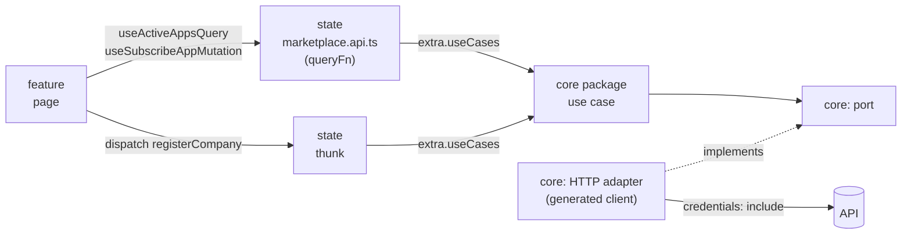

# 06 – Data flow & Redux Toolkit

This chapter shows how **our React apps** (`apps/portal`, `apps/registration`) consume the core packages. Redux Toolkit is the only state mechanism here. The core packages themselves know nothing about Redux ([04](./04-core-packages.md)).

## The big picture



- **Reads and simple writes**: RTK Query endpoints whose `queryFn` calls a core use case. RTK Query adds caching, loading state and tag invalidation.
- **Long-running workflows with progress** (e.g. register a company): a thunk that calls the use case and turns its `onStep` callback into actions.
- There is **no `fetchBaseQuery`** and no handwritten URL in our React code: transport and mapping exist only once, in the core package.

## Step 1 – `libs/shared/state-core`

### Types

```ts
// libs/shared/state-core/src/data/use-case-registry.data.ts
import type { CoreHttpErrorData } from '@portal/core-http';

// Each module's state lib adds its core module here via declaration merging.
// eslint-disable-next-line @typescript-eslint/no-empty-interface
export interface UseCaseRegistry {}

export interface ThunkExtra {
  useCases: UseCaseRegistry;
}

export interface AppThunkConfig {
  extra: ThunkExtra;
  rejectValue: CoreHttpErrorData;
}

export type UseCaseQueryResult<T> = { data: T } | { error: CoreHttpErrorData };
```

```ts
// libs/shared/state-core/src/data/portal-store-options.data.ts
import type { Slice } from '@reduxjs/toolkit';
import type { ThunkExtra } from './use-case-registry.data';

export interface PortalStoreOptions {
  slices: ReadonlyArray<Slice>;
  extra: ThunkExtra;
}
```

### The single API

```ts
// libs/shared/state-core/src/portal.api.ts
import { createApi, fakeBaseQuery } from '@reduxjs/toolkit/query/react';
import type { CoreHttpErrorData } from '@portal/core-http';

export const portalApi = createApi({
  reducerPath: 'portalApi',
  baseQuery: fakeBaseQuery<CoreHttpErrorData>(),
  tagTypes: ['Session', 'App', 'Service', 'User', 'Company'],
  endpoints: () => ({}),
});
```

`fakeBaseQuery` because every endpoint uses `queryFn`. Modules add their endpoints with `injectEndpoints`.

### Helpers

```ts
// libs/shared/state-core/src/get-use-cases.ts
import type { BaseQueryApi } from '@reduxjs/toolkit/query';
import type { ThunkExtra, UseCaseRegistry } from './data/use-case-registry.data';

export function getUseCases(api: Pick<BaseQueryApi, 'extra'>): UseCaseRegistry {
  return (api.extra as ThunkExtra).useCases;
}
```

```ts
// libs/shared/state-core/src/to-query-result.ts
import { CoreHttpErrorFactory } from '@portal/core-http';
import type { UseCaseQueryResult } from './data/use-case-registry.data';

export async function toQueryResult<T>(run: () => Promise<T>): Promise<UseCaseQueryResult<T>> {
  try {
    return { data: await run() };
  } catch (error) {
    return { error: CoreHttpErrorFactory.from(error) };
  }
}
```

```ts
// libs/shared/state-core/src/create-app-async-thunk.ts
import { createAsyncThunk } from '@reduxjs/toolkit';
import type { AppThunkConfig } from './data/use-case-registry.data';

export const createAppAsyncThunk = createAsyncThunk.withTypes<AppThunkConfig>();
```

```ts
// libs/shared/state-core/src/listener.middleware.ts
import { createListenerMiddleware } from '@reduxjs/toolkit';

export const listenerMiddleware = createListenerMiddleware();
```

### Store factory

```ts
// libs/shared/state-core/src/create-portal-store.ts
import { combineSlices, configureStore } from '@reduxjs/toolkit';
import type { PortalStoreOptions } from './data/portal-store-options.data';
import { listenerMiddleware } from './listener.middleware';
import { portalApi } from './portal.api';

export function createPortalStore(options: PortalStoreOptions) {
  return configureStore({
    reducer: combineSlices(portalApi, ...options.slices),
    middleware: (getDefaultMiddleware) =>
      getDefaultMiddleware({
        thunk: { extraArgument: options.extra },
        serializableCheck: { ignoredActionPaths: ['meta.arg', 'meta.baseQueryMeta'] },
      })
        .prepend(listenerMiddleware.middleware)
        .concat(portalApi.middleware),
  });
}
```

`meta.arg` is ignored by the serializable check because some use case inputs contain files (`Blob`). State itself stays serialisable.

## Step 2 – A module's state lib: `libs/marketplace/state`

### Register the core module

```ts
// libs/marketplace/state/src/data/marketplace-use-cases.data.ts
import type { MarketplaceModule } from '@portal/marketplace-core';

declare module '@portal/shared-state-core' {
  interface UseCaseRegistry {
    marketplace: MarketplaceModule;
  }
}
```

After this, `getUseCases(api).marketplace` and `extra.useCases.marketplace` are fully typed.

### Endpoints

```ts
// libs/marketplace/state/src/marketplace.api.ts
import { AppIdFactory, type AppAnemic } from '@portal/marketplace-core';
import { getUseCases, portalApi, toQueryResult } from '@portal/shared-state-core';
import './data/marketplace-use-cases.data';

export const marketplaceApi = portalApi.injectEndpoints({
  endpoints: (build) => ({
    activeApps: build.query<ReadonlyArray<AppAnemic>, void>({
      queryFn: (_arg, api) => toQueryResult(() => getUseCases(api).marketplace.listActiveApps.execute()),
      providesTags: ['App'],
    }),
    appById: build.query<AppAnemic | null, string>({
      queryFn: (id, api) => toQueryResult(() => getUseCases(api).marketplace.getApp.execute(AppIdFactory.create(id))),
      providesTags: (_result, _error, id) => [{ type: 'App', id }],
    }),
    subscribeApp: build.mutation<void, string>({
      queryFn: (id, api) => toQueryResult(() => getUseCases(api).marketplace.subscribeToApp.execute(AppIdFactory.create(id))),
      invalidatesTags: (_result, _error, id) => ['App', { type: 'App', id }],
    }),
  }),
});
```

### Hooks for the feature lib

```ts
// libs/marketplace/state/src/hooks.ts
import { marketplaceApi } from './marketplace.api';

export const { useActiveAppsQuery, useAppByIdQuery, useSubscribeAppMutation } = marketplaceApi;
```

### Slice (UI state only)

```ts
// libs/marketplace/state/src/slices/app-filter.initial-state.ts
import type { AppFilter } from '@portal/marketplace-core';

export const APP_FILTER_INITIAL_STATE: AppFilter = { search: '', useCase: null };
```

```ts
// libs/marketplace/state/src/slices/app-filter.slice.ts
import { createSlice, type PayloadAction } from '@reduxjs/toolkit';
import { APP_FILTER_INITIAL_STATE } from './app-filter.initial-state';

export const appFilterSlice = createSlice({
  name: 'marketplace/appFilter',
  initialState: APP_FILTER_INITIAL_STATE,
  reducers: {
    searchChanged: (state, action: PayloadAction<string>) => {
      state.search = action.payload;
    },
    useCaseSelected: (state, action: PayloadAction<string | null>) => {
      state.useCase = action.payload;
    },
  },
});
```

### Selector

```ts
// libs/marketplace/state/src/selectors/select-filtered-apps.selector.ts
import { createSelector } from '@reduxjs/toolkit';
import { marketplaceApi } from '../marketplace.api';
import { appFilterSlice } from '../slices/app-filter.slice';

export const selectFilteredApps = createSelector(
  [marketplaceApi.endpoints.activeApps.select(), appFilterSlice.selectSlice],
  (result, filter) => {
    const apps = result.data ?? [];
    return apps.filter((app) => {
      if (filter.useCase !== null && !app.useCases.includes(filter.useCase)) {
        return false;
      }
      return app.name.toLowerCase().includes(filter.search.toLowerCase());
    });
  },
);
```

### Page

```tsx
// libs/marketplace/feature/src/pages/app-detail.page.tsx
import { useParams } from 'react-router';
import { useAppByIdQuery, useSubscribeAppMutation } from '@portal/marketplace-state';
import { Button, Typography } from '@portal/shared-ui-mui';
import { PageLoader, QueryError } from '@portal/shared-ui-feedback';
import { useTranslation } from '@portal/shared-i18n';

export default function AppDetailPage() {
  const { appId = '' } = useParams();
  const { t } = useTranslation('marketplace');
  const { data: app, error, isLoading } = useAppByIdQuery(appId);
  const [subscribe, { isLoading: isSubscribing }] = useSubscribeAppMutation();

  if (isLoading) {
    return <PageLoader />;
  }
  if (error !== undefined || app === undefined || app === null) {
    return <QueryError error={error} />;
  }
  return (
    <>
      <Typography variant="h2">{app.name}</Typography>
      <Typography>{app.provider}</Typography>
      <Button
        disabled={!app.canSubscribe || isSubscribing}
        onClick={() => {
          void subscribe(app.id);
        }}
      >
        {t('appdetail.subscribe')}
      </Button>
    </>
  );
}
```

## Step 3 – A workflow with progress: register a company

The registration use case reports progress via `onStep` ([04](./04-core-packages.md#example-portalregistration-core--register-a-company)). The state lib turns that into actions.

```ts
// libs/registration/state/src/data/registration-use-cases.data.ts
import type { RegistrationModule } from '@portal/registration-core';

declare module '@portal/shared-state-core' {
  interface UseCaseRegistry {
    registration: RegistrationModule;
  }
}
```

```ts
// libs/registration/state/src/data/registration-progress.data.ts
import type { RegisterCompanyResult, RegistrationStep } from '@portal/registration-core';

export interface RegistrationProgressState {
  currentStep: RegistrationStep | null;
  result: RegisterCompanyResult | null;
}
```

```ts
// libs/registration/state/src/actions/registration-step-started.action.ts
import { createAction } from '@reduxjs/toolkit';
import type { RegistrationStep } from '@portal/registration-core';

export const registrationStepStarted = createAction<RegistrationStep>('registration/stepStarted');
```

```ts
// libs/registration/state/src/thunks/register-company.thunk.ts
import type { RegisterCompanyData } from '@portal/registration-core';
import { createAppAsyncThunk } from '@portal/shared-state-core';
import { registrationStepStarted } from '../actions/registration-step-started.action';
import '../data/registration-use-cases.data';

export const registerCompany = createAppAsyncThunk(
  'registration/registerCompany',
  (input: RegisterCompanyData, { extra, dispatch }) =>
    extra.useCases.registration.registerCompany.execute(input, {
      onStep: (step) => {
        dispatch(registrationStepStarted(step));
      },
    }),
);
```

```ts
// libs/registration/state/src/slices/registration-progress.initial-state.ts
import type { RegistrationProgressState } from '../data/registration-progress.data';

export const REGISTRATION_PROGRESS_INITIAL_STATE: RegistrationProgressState = { currentStep: null, result: null };
```

```ts
// libs/registration/state/src/slices/registration-progress.slice.ts
import { createSlice } from '@reduxjs/toolkit';
import { registrationStepStarted } from '../actions/registration-step-started.action';
import { registerCompany } from '../thunks/register-company.thunk';
import { REGISTRATION_PROGRESS_INITIAL_STATE } from './registration-progress.initial-state';

export const registrationProgressSlice = createSlice({
  name: 'registration/progress',
  initialState: REGISTRATION_PROGRESS_INITIAL_STATE,
  reducers: {},
  extraReducers: (builder) => {
    builder
      .addCase(registerCompany.pending, () => REGISTRATION_PROGRESS_INITIAL_STATE)
      .addCase(registrationStepStarted, (state, action) => {
        state.currentStep = action.payload;
      })
      .addCase(registerCompany.fulfilled, (state, action) => {
        state.currentStep = null;
        state.result = action.payload;
      });
  },
});
```

The action lives in its own file so that thunk and slice do not import each other.

## Step 4 – Composition root (one per app)

There are two apps: `apps/portal` and `apps/registration` ([11](./11-implementation-roadmap.md#phase-6--registration-app)). Both need the same core configuration: base URL, CSRF token and "redirect to login on 401". That part is written once, in the identity state lib:

```ts
// libs/identity/state/src/data/core-context.data.ts
import type { CoreModuleConfig } from '@portal/core-http';
import type { IdentityModule } from '@portal/identity-core';

export interface CoreContext {
  identity: IdentityModule;
  moduleConfig: CoreModuleConfig;
}
```

```ts
// libs/identity/state/src/create-core-context.ts
import { CsrfTokenStore, type CoreModuleConfig } from '@portal/core-http';
import { createIdentityModule } from '@portal/identity-core';
import type { CoreContext } from './data/core-context.data';

export function createCoreContext(baseUrl: string): CoreContext {
  const baseConfig: CoreModuleConfig = {
    baseUrl,
    getCsrfToken: () => CsrfTokenStore.get(),
  };
  const identity = createIdentityModule(baseConfig);
  return {
    identity,
    moduleConfig: {
      ...baseConfig,
      onUnauthorized: () => {
        identity.login.execute(window.location.pathname);
      },
    },
  };
}
```

The identity module gets no `onUnauthorized`: a 401 on `/me` is the normal "not logged in" answer, which its use case handles itself ([05](./05-auth-and-session.md)).

### `apps/portal`

```ts
// apps/portal/src/container.ts
import { createCoreContext } from '@portal/identity-state';
import { createMarketplaceModule } from '@portal/marketplace-core';
import { ENV } from '@portal/shared-infrastructure-config';
import type { UseCaseRegistry } from '@portal/shared-state-core';

export function createUseCases(): UseCaseRegistry {
  const { identity, moduleConfig } = createCoreContext(ENV.apiBaseUrl);
  return {
    identity,
    marketplace: createMarketplaceModule(moduleConfig),
  };
}
```

```ts
// apps/portal/src/store.ts
import { appFilterSlice } from '@portal/marketplace-state';
import { createPortalStore } from '@portal/shared-state-core';
import { createUseCases } from './container';

export const store = createPortalStore({
  slices: [appFilterSlice],
  extra: { useCases: createUseCases() },
});
```

### `apps/registration`

```ts
// apps/registration/src/container.ts
import { createCoreContext } from '@portal/identity-state';
import { createRegistrationModule } from '@portal/registration-core';
import { ENV } from '@portal/shared-infrastructure-config';
import type { UseCaseRegistry } from '@portal/shared-state-core';

export function createUseCases(): UseCaseRegistry {
  const { identity, moduleConfig } = createCoreContext(ENV.apiBaseUrl);
  return {
    identity,
    registration: createRegistrationModule(moduleConfig),
  };
}
```

```ts
// apps/registration/src/store.ts
import { registrationProgressSlice } from '@portal/registration-state';
import { createPortalStore } from '@portal/shared-state-core';
import { createUseCases } from './container';

export const store = createPortalStore({
  slices: [registrationProgressSlice],
  extra: { useCases: createUseCases() },
});
```

`UseCaseRegistry` only contains the modules whose state libs an app imports (each state lib adds itself by declaration merging), so each container returns exactly its own modules.

`store.ts` is imported only after `await loadEnv()` ([07](./07-runtime-config-and-deployment.md)), so `ENV.apiBaseUrl` is available.

## Cross-module reactions

Core packages never import each other. When one module must react to another (e.g. "after subscribing an app, refresh the company subscriptions"), the UI layer connects them. For us that is RTK's listener middleware:

```ts
// libs/administration/state/src/listeners/refresh-subscriptions.listener.ts
import { marketplaceApi } from '@portal/marketplace-state';
import { listenerMiddleware } from '@portal/shared-state-core';
import { administrationApi } from '../administration.api';

export function registerRefreshSubscriptionsListener(): void {
  listenerMiddleware.startListening({
    matcher: marketplaceApi.endpoints.subscribeApp.matchFulfilled,
    effect: (_action, api) => {
      api.dispatch(administrationApi.util.invalidateTags(['Company']));
    },
  });
}
```

The app calls every `register…Listener()` once at startup.

## Errors

- Core packages throw `CoreHttpException` for HTTP failures and return result unions for expected outcomes (`invalid`, `failed`).
- `toQueryResult` turns exceptions into plain `CoreHttpErrorData`, which RTK Query stores as the endpoint error.
- Components render errors with `shared/ui-feedback` (`QueryError`), thunks expose `result` in their slice.
- 401 is never handled in components: `onUnauthorized` in the core config redirects to login.
