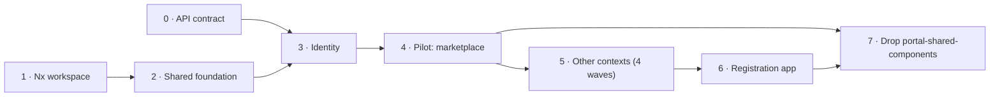

# 10 – Implementation roadmap

Eight phases. Phases 0 and 1 run in parallel with the API rewrite. From phase 3 on, everything depends on `GET /me` (real or mocked). Every phase ends with a definition of done (DoD) that CI or a reviewer can check.

---

## Phase 0 – Contract with the API team

**Goal:** the frontend can develop against a mock that matches the future API.

1. Agree the BFF endpoints `/auth/login`, `/auth/logout`, `/me`, `/config` and their `snake_case` fields ([04](./04-auth-and-session.md)).
2. Build the permission key list and the mapping from legacy roles (in `portal-frontend`: `ROLES` in `types/Constants.ts`, `allowTo` in `ALL_PAGES`/`ALL_ACTIONS`/`ALL_OVERLAYS` of `types/Config.tsx`, `services/AccessService.tsx`).
3. Agree CORS (allowed origins, credentials), cookie attributes and the CSRF token in `/me`.
4. Agree OpenAPI as the single source for DTOs and where the spec URL is published per environment.
5. Write MSW handlers for the four auth endpoints in `identity/infrastructure/src/mocks`.

**DoD:** OpenAPI spec for auth/session exists; MSW serves it; the permission mapping table is reviewed by the API team.

---

## Phase 1 – Nx workspace

**Goal:** an empty app that builds, and lint that blocks layer violations.

1. Generate `apps/portal` ([02](./02-workspace-and-tooling.md#step-by-step-finish-the-workspace)).
2. Install the dependencies listed in [02](./02-workspace-and-tooling.md).
3. Pin TypeScript 6.0.3 exactly; Renovate rule against TS majors.
4. ESLint flat config with module boundaries, restricted imports, `curly`, `max-classes-per-file`.
5. Commit a deliberately wrong import in a throwaway branch and confirm `nx lint` fails.
6. Write the context generator `@portal/tools:context` ([11](./11-adding-a-context.md)).
7. CI pipeline with `nx affected -t lint typecheck test build e2e`, lint-staged + Prettier.

**DoD:** `nx build portal` is green; a layer violation fails CI; `nx g @portal/tools:context demo --dry-run` shows all five libs with tags.

---

## Phase 2 – Shared foundation

**Goal:** the app shell renders entirely from shared libs.

1. New `libs/shared/ui-mui` on MUI 9: theme, augments, hooks and the first wrappers the shell needs (button, typography, menu, navigation, dialog).
2. New `libs/shared/ui-layout`, modelled on `components/shared/frame` of `portal-frontend` (header, footer, mobile menu, user info, breadcrumb); logo from config state, not a static asset.
3. New `libs/shared/i18n` with a provider; move the shell translations (`main`, `footer`) from `src/assets/locales`.
4. New `libs/shared/ui-feedback` (`ErrorBoundary` after `components/pages/ErrorBoundary`, `RouteError`, `AccessDenied`, `PageLoader`).
5. New `libs/shared/infrastructure-config` (`loadEnv`, `ENV`, zod schema) and the async bootstrap in `main.tsx` ([06](./06-runtime-config-and-deployment.md)).
6. New `libs/shared/infrastructure-http` (`portalApi`, `portalBaseQuery`, `CsrfStore`, `LoginRedirect`, `ApiError`, `isNotFound`).
7. New `libs/shared/state-core`, replacing the legacy `features/store.ts` with its 36+ separate APIs (`createPortalStore`, `UseCaseRegistry`, `ThunkExtra`, `createAppAsyncThunk`, typed hooks, listener middleware).
8. New `libs/shared/domain-kernel` (`Id`, `Bpn`, `Email`, `PermissionKey`, `Page<T>`, `PageDefinition`, `MenuItemDefinition`).
9. Dockerfile + nginx config for the app.

**DoD:** `apps/portal` shows layout, theme and translations; `apps/portal/src` contains only `main.tsx`, `render-app.tsx`, `router.tsx`, `store.ts`, `dispatch-holder.ts`, `container.ts`, page registry and menu config; the Docker image starts with a mounted `config.json`.

---

## Phase 3 – Identity context

**Goal:** login and logout work through the BFF; no Keycloak code anywhere.

1. Generate the context: `nx g @portal/tools:context identity`.
2. Domain: `UserAnemic`, `SessionAnemic`, `PermissionKey` usage, `HasPermissionDomain`, ports `SessionRepository`, `RedirectPort`.
3. Application: `GetCurrentSessionUseCase`, `LoginUseCase`, `LogoutUseCase`.
4. Infrastructure: `identityApi` (`me`, `logout`), `SessionMapper`, `SessionRtkRepository`, `BrowserRedirectAdapter`; store the CSRF token in `CsrfStore` when `/me` succeeds.
5. State: `session` slice, `selectHasPermission`, `selectVisibleMenu`, `bootstrapSession` and `logout` thunks, `useHasPermission`.
6. Feature: `SessionGate`, `RequireAccess`, `UserMenu`.
7. Convert all page definitions from `allowTo` to `permission`.

**DoD:** login redirect and logout work against the MSW BFF and, once available, the real API; `keycloak-js` is not in any `package.json`; E2E covers "not logged in → redirect" and "missing permission → AccessDenied".

---

## Phase 4 – Pilot: marketplace

**Goal:** one complete context that serves as the template for all others.

1. Apps list, app detail, favourites, subscribe – through all five layers.
2. Tests: use cases with in-memory repositories, selectors, mappers, one feature test with MSW, one Playwright journey.
3. A `README.md` inside `libs/marketplace/` that points to the files as examples.
4. Update the context generator with anything the pilot taught you.

**DoD:** functionally equal to the legacy marketplace; coverage ≥ 90 % for `marketplace-domain` and `marketplace-application`; the team agrees it is the reference.

---

## Phase 5 – Remaining contexts in waves

Each context follows [11](./11-adding-a-context.md). Context cuts follow the legacy `portal-frontend/src/features/*` folders, grouped by business domain.

| Wave | Contexts | Legacy sources |
|------|----------|----------------|
| 1 | service-marketplace, notification, info (news, static content) | `serviceMarketplace`, `notification`, `info`, `staticContent` |
| 2 | administration (users, technical users, IdP, company data/roles, certificates, wallet, connectors, delete company) | `admin`, `companyData`, `companyRoles`, `companyCertification`, `compayWallet`, `connector`, `deleteCompany` |
| 3 | app-management, service-management, admin-board (release process, subscriptions, clearinghouse, credentials) | `appManagement`, `appSubscription`, `serviceManagement`, `serviceSubscription`, `adminBoard`, `adminClearingHouseSD`, `certification` |
| 4 | partner-network (BPDM), semantic-hub | `partnerNetwork`, `newPartnerNetwork`, `semanticModels` – only once the API proxies BPDM and semantics |

**DoD per wave:** all pages of the wave are in the page registry; the wave's legacy `createApi` instances have no counterpart left; E2E for the main flow of each context.

---

## Phase 6 – Registration app

1. `nx g @nx/react:app apps/registration` with the same libs and bootstrap.
2. Context `registration` (application, company role, documents, invite, verify) from `portal-frontend-registration/src/state/features/*`.
3. Router 5, axios, Bootstrap, redux-actions and the separate Keycloak client are not carried over.

**DoD:** registration runs on the same BFF session; no axios or Bootstrap in the workspace.

---

## Phase 7 – Drop `portal-shared-components`

1. Find remaining uses of `@catena-x/portal-shared-components`; replace each with a `shared/ui-mui` component.
2. Remove the `paths` alias and the package.
3. Optional: Storybook for `shared/ui-mui` with `@nx/storybook`.

**DoD:** the package is not in any `package.json`; no jQuery in the bundle.
