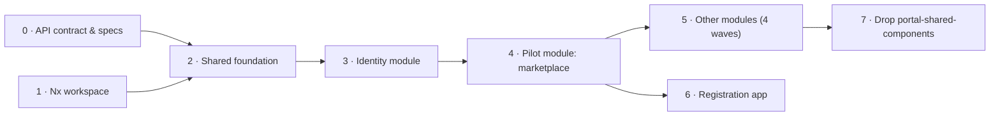

# 11 – Implementation roadmap

Eight phases. Phases 0 and 1 run in parallel with the API rewrite. From phase 3 on, everything depends on `GET /me` (real or mocked). Every phase ends with a definition of done (DoD) that CI or a reviewer can check.



---

## Phase 0 – Contract with the API team

**Goal:** every module has an `openapi.yaml` we can generate from, and a mock we can develop against.

1. Agree that every backend module provides an `openapi.yaml` with each release, with `snake_case` fields. The backend does not exist yet: write the first specs for identity, marketplace and registration together with the API team.
2. Agree the BFF endpoints `/auth/login`, `/auth/logout`, `/me`, `/config` ([05](./05-auth-and-session.md)).
3. Build the permission key list and the mapping from legacy roles (in `portal-frontend`: `ROLES` in `types/Constants.ts`, `allowTo` in `ALL_PAGES`/`ALL_ACTIONS`/`ALL_OVERLAYS` of `types/Config.tsx`, `services/AccessService.tsx`).
4. Agree CORS (allowed origins, credentials), cookie attributes and the CSRF token in `/me`.
5. Put the first specs into `specs/identity/`, `specs/marketplace/`, `specs/registration/` – by hand now, later via the sync workflow ([04](./04-core-packages.md#getting-a-spec-into-the-workspace)).

**DoD:** specs for identity, registration and marketplace exist in `specs/`; the permission mapping table is reviewed by the API team.

---

## Phase 1 – Nx workspace

**Goal:** an empty app and empty core packages that build, and lint that blocks every boundary violation.

1. Add `packages/*` to the npm workspaces ([02](./02-workspace-and-tooling.md#step-by-step-finish-the-workspace)).
2. Generate `apps/portal`.
3. Install the dependencies listed in [02](./02-workspace-and-tooling.md); pin TypeScript 6.0.3 exactly.
4. ESLint flat config with module boundaries, core layer zones, restricted imports, `curly`, `max-classes-per-file`.
5. In a throwaway branch: React import in a core package, `openapi-fetch` import in a feature lib, `application` importing `infrastructure` inside a core package. All three must fail `nx lint`.
6. Write the module generator `@portal/tools:module` ([12](./12-adding-a-module.md)).
7. CI pipeline with `nx affected -t lint typecheck test build check-api e2e`, lint-staged + Prettier.

**DoD:** `nx build portal` is green; the three violations fail CI; `nx g @portal/tools:module demo --dry-run` shows the core package and both libs with tags.

---

## Phase 2 – Shared foundation

**Goal:** the shared core packages exist and the app shell renders from shared libs.

Core (framework-free):

1. `packages/core-http`: `CoreModuleConfig`, `createCoreClient`, `ensureData`, `ensureOk`, `toFormData`, `CoreHttpException`, `CoreHttpErrorFactory`, `CsrfTokenStore`, `HTTP` constants ([04](./04-core-packages.md#portalcore-http)).
2. `packages/core-kernel`: `ErrorMessage`, `PermissionKey` + factory, `Bpn` + factory, paging types.

React portal:

3. `libs/shared/ui-mui` on MUI 9: theme, augments, hooks and the first wrappers the shell needs (button, typography, menu, navigation, dialog).
4. `libs/shared/ui-layout`, modelled on `components/shared/frame` of `portal-frontend` (header, footer, mobile menu, user info, breadcrumb); logo from `/config`, not a static asset.
5. `libs/shared/i18n` with a provider; move the shell translations (`main`, `footer`) from `src/assets/locales`.
6. `libs/shared/ui-feedback`: `ErrorBoundary` (after `components/pages/ErrorBoundary`), `RouteError`, `AccessDenied`, `PageLoader`, `QueryError`.
7. `libs/shared/infrastructure-config`: `loadEnv`, `ENV`, zod schema, async bootstrap in `main.tsx` ([07](./07-runtime-config-and-deployment.md)).
8. `libs/shared/state-core`: `portalApi` (`fakeBaseQuery`), `UseCaseRegistry`, `getUseCases`, `toQueryResult`, `createAppAsyncThunk`, `listenerMiddleware`, `createPortalStore` ([06](./06-data-flow-redux.md)). It replaces the legacy `features/store.ts` with its 36+ separate APIs.
9. `libs/shared/util`: `PageDefinition`, `MenuItemDefinition`.
10. Dockerfile + nginx config for the app.

**DoD:** `core-http` and `core-kernel` have ≥ 90 % coverage; `apps/portal` shows layout, theme and translations; the Docker image starts with a mounted `config.json`.

---

## Phase 3 – Identity module

**Goal:** login and logout work through the BFF; no Keycloak code anywhere.

1. `nx g @portal/tools:module identity`, then `nx run identity-core:generate-api`.
2. `@portal/identity-core`: anemics, `HasPermissionDomain`, ports, `GetCurrentSessionUseCase`, `LoginUseCase`, `LogoutUseCase`, `SessionHttpRepository`, `BrowserRedirectAdapter`, `CsrfTokenAdapter`, `createIdentityModule`, MSW mock BFF ([05](./05-auth-and-session.md)).
3. `libs/identity/state`: `identityApi` (`currentSession`, `logout`), `useHasPermission`, `useVisibleMenu`.
4. `libs/identity/feature`: `SessionGate`, `RequireAccess`, `UserMenu`.
5. `apps/portal/src/container.ts` and `store.ts` with the identity module.
6. Convert all page definitions from the legacy `allowTo` checks to `permission` keys.

**DoD:** login redirect and logout work against the MSW BFF and, once available, the real API; `keycloak-js` is not in any `package.json`; E2E covers "not logged in → redirect" and "missing permission → AccessDenied".

---

## Phase 4 – Pilot module: marketplace

**Goal:** one complete module in `apps/portal` that serves as the template for all others.

1. `nx g @portal/tools:module marketplace`, then `nx run marketplace-core:generate-api`.
2. `@portal/marketplace-core`: list, detail, subscribe, favourites as use cases; `can_subscribe` and similar decisions come from the API as flags ([03](./03-layers-and-libs.md)).
3. `libs/marketplace/state`: endpoints with `queryFn`, filter slice, selectors ([06](./06-data-flow-redux.md)).
4. `libs/marketplace/feature`: pages, page definitions, translations.
5. Tests per [10](./10-testing.md): use cases with in-memory repositories, adapters with MSW, one feature test and one Playwright journey.
6. A `README.md` in `packages/marketplace-core` that points to its files as examples; update the module generator with what the pilot taught.

**DoD:** functionally equal to the legacy marketplace; coverage ≥ 90 % for `marketplace-core` `domain` and `application`; the team agrees it is the reference.

---

## Phase 5 – Remaining modules in waves

Each module follows [12](./12-adding-a-module.md). The cuts follow the backend modules and their specs; the legacy `portal-frontend/src/features/*` folders show which UI belongs where.

| Wave | Modules | Legacy sources in `portal-frontend` |
|------|---------|-------------------------------------|
| 1 | service-marketplace, notification, info (news, static content) | `serviceMarketplace`, `notification`, `info`, `staticContent` |
| 2 | administration (users, technical users, IdP, company data/roles, certificates, wallet, connectors, delete company) | `admin`, `companyData`, `companyRoles`, `companyCertification`, `compayWallet`, `connector`, `deleteCompany` |
| 3 | app-management, service-management, admin-board (release process, subscriptions, clearinghouse, credentials) | `appManagement`, `appSubscription`, `serviceManagement`, `serviceSubscription`, `adminBoard`, `adminClearingHouseSD`, `certification` |
| 4 | partner-network (BPDM), semantic-hub | `partnerNetwork`, `newPartnerNetwork`, `semanticModels` – only once the API proxies BPDM and semantics |

**DoD per wave:** every module of the wave has a complete core package, its pages are in the page registry, and the matching legacy `createApi` instances have no counterpart left.

---

## Phase 6 – Registration app

**Goal:** company registration runs as its own Nx app on the same libs, core packages and BFF session. The scope of registration is still TBD; the app structure is fixed.

1. Generate the app:
   ```bash
   npx nx g @nx/react:app apps/registration --bundler=vite --linter=eslint --unitTestRunner=vitest --e2eTestRunner=playwright --style=css --routing
   ```
   Tags: `type:app`, `scope:app`.
2. Same bootstrap as the portal: `loadEnv()`, `render-app.tsx`, its own `container.ts` and `store.ts` with `createCoreContext` ([06](./06-data-flow-redux.md#appsregistration)).
3. `nx g @portal/tools:module registration`, then `nx run registration-core:generate-api`.
4. `@portal/registration-core` with `RegisterCompanyUseCase` ([04](./04-core-packages.md#example-portalregistration-core--register-a-company)); the source for the flow is `portal-frontend-registration/src/state/features/*`.
5. `libs/registration/state` (thunk + progress slice) and `libs/registration/feature` (wizard pages).
6. Own Docker image and Kubernetes deployment, same `config.json` mechanism ([07](./07-runtime-config-and-deployment.md)).
7. Router 5, axios, Bootstrap, redux-actions and the separate Keycloak client of the legacy app are not carried over.

**DoD:** "register a company" works end to end against the MSW mocks and, once available, the real API; `apps/registration` has its own E2E journey; no axios or Bootstrap in the workspace.

---

## Phase 7 – Drop `portal-shared-components`

1. Find remaining uses of `@catena-x/portal-shared-components` in our portal; replace each with a `libs/shared/ui-mui` component.
2. Remove the package.
3. Optional: Storybook for `libs/shared/ui-mui` with `@nx/storybook`.

**DoD:** the package is not in any `package.json`; no jQuery in the bundle.
