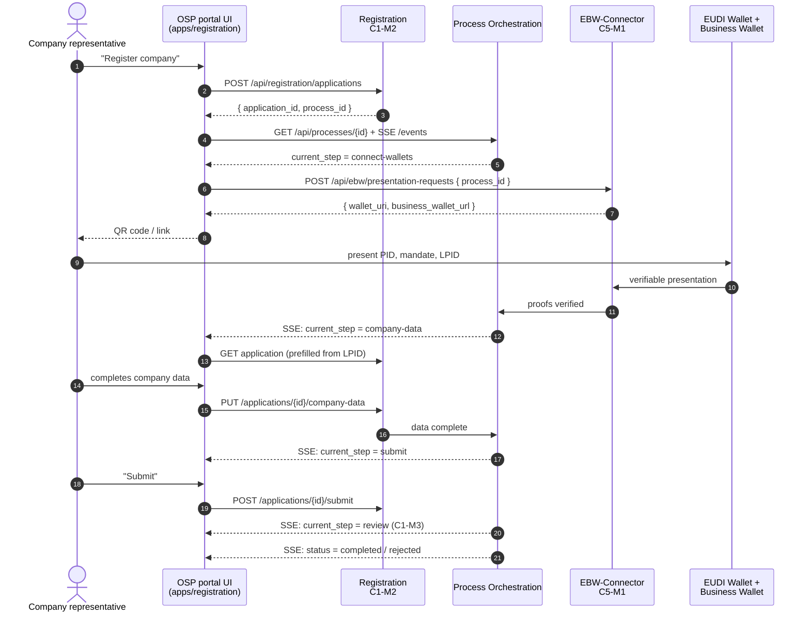

# 14 – Example: company registration in OSP 2.0

This chapter sketches one complete frontend building block: **a company registers at an OSP**. It follows the OSP 2.0 decisions of 28 Oct 2026 and touches three portal modules:

| Module | Id | Role in the flow |
|--------|----|------------------|
| EBW-Connector | C5-M1 | Checks the EUDI Wallet of the person (PID, mandate) and the Business Wallet of the company (LPID). Provided for the hackathon |
| Registration | C1-M2 | Holds the application and its company data |
| Process Orchestration | – | Runs every step of the flow and says which step is next |

After submission the application goes to **Application review (C1-M3)**; once approved, the company gets its profile (C3-M1) and its BPN via the CSP. Those parts are not built by the registration UI – it only shows the status.

> This replaces the simplified example in [04](./04-core-packages.md#example-portalregistration-core--register-a-company), where the frontend ran six calls in a row. In OSP 2.0 the **Process Orchestration** runs the steps. The frontend only renders the step the backend reports.

---

## Who decides what

| Question | Decided by | The frontend… |
|----------|-----------|---------------|
| Which step comes next? | Process Orchestration | renders the component for `current_step` |
| Are the wallet proofs valid? | EBW-Connector | shows the presentation request (QR code / link) and waits |
| Which company data is already verified? | Registration (from the LPID) | shows verified fields read-only |
| Is the application complete and valid? | Registration | shows the error keys the API returns |
| Is the company admitted? | Application review (C1-M3) | shows "in review", then the result |

The frontend never computes a step, a validity or an approval. It reacts to the process state, which arrives as **server-sent events** (SSE), not WebSockets and not polling.

## The flow



All paths and field names are **assumptions** until the modules publish their `openapi.yaml`. They are written in `snake_case` and only change inside the core packages' adapters.

---

## Building blocks

One framework-free core package per backend module, as in [04](./04-core-packages.md):

```text
packages/
  process-core/          # @portal/process-core          – process state + SSE
  ebw-connector-core/    # @portal/ebw-connector-core    – presentation requests
  registration-core/     # @portal/registration-core     – application data, submit
libs/
  process/state/
  ebw-connector/state/  ebw-connector/feature/   # wallet step, reusable for sign-in
  registration/state/   registration/feature/    # pages and steps of the wizard
apps/
  registration/
```

The registration feature is the only place that combines the three modules. For that, `scope:registration` may depend on `scope:process` and `scope:ebw-connector` (one extra line in the boundary rules, see the end of this chapter).

---

## `@portal/process-core`

### Domain

```ts
// src/domain/data/process.data.ts
export type ProcessStatus = 'running' | 'waiting-for-user' | 'completed' | 'rejected';

export type ProcessStepStatus = 'open' | 'active' | 'done' | 'failed';

export interface ProcessStepData {
  key: string;
  status: ProcessStepStatus;
}

export type Unsubscribe = () => void;
```

```ts
// src/domain/anemics/process.anemic.ts
import type { ProcessStatus, ProcessStepData } from '../data/process.data';

export type ProcessAnemic = Readonly<{
  id: string;
  status: ProcessStatus;
  currentStep: string | null;
  steps: ReadonlyArray<ProcessStepData>;
}>;
```

```ts
// src/domain/repositories/process.repository.ts
import type { ProcessAnemic } from '../anemics/process.anemic';
import type { Unsubscribe } from '../data/process.data';

export interface ProcessRepository {
  findById(id: string): Promise<ProcessAnemic>;
  watch(id: string, onChange: (process: ProcessAnemic) => void): Unsubscribe;
}
```

### Application

```ts
// src/application/useCases/get-process.use-case.ts
import type { ProcessAnemic } from '../../domain/anemics/process.anemic';
import type { ProcessRepository } from '../../domain/repositories/process.repository';

export class GetProcessUseCase {
  constructor(private readonly processes: ProcessRepository) {}

  public execute(id: string): Promise<ProcessAnemic> {
    return this.processes.findById(id);
  }
}
```

```ts
// src/application/useCases/watch-process.use-case.ts
import type { ProcessAnemic } from '../../domain/anemics/process.anemic';
import type { Unsubscribe } from '../../domain/data/process.data';
import type { ProcessRepository } from '../../domain/repositories/process.repository';

export class WatchProcessUseCase {
  constructor(private readonly processes: ProcessRepository) {}

  public execute(id: string, onChange: (process: ProcessAnemic) => void): Unsubscribe {
    return this.processes.watch(id, onChange);
  }
}
```

### Infrastructure

```ts
// src/infrastructure/data/process-infrastructure.data.ts
import type { Client } from 'openapi-fetch';
import type { components, paths } from '../../generated/process-api';

export type ProcessClient = Client<paths>;
export type ProcessDto = components['schemas']['ProcessResponse'];
```

```ts
// src/infrastructure/constants/process-path.constant.ts
export const PROCESS_PATH = {
  EVENTS: (id: string) => `/api/processes/${encodeURIComponent(id)}/events`,
  EVENT_NAME: 'process-changed',
} as const;
```

```ts
// src/infrastructure/mappers/process.mapper.ts
import type { ProcessAnemic } from '../../domain/anemics/process.anemic';
import type { ProcessDto } from '../data/process-infrastructure.data';

export class ProcessMapper {
  public static toAnemic(dto: ProcessDto): ProcessAnemic {
    return {
      id: dto.process_id,
      status: dto.status,
      currentStep: dto.current_step ?? null,
      steps: dto.steps.map((step) => ({ key: step.key, status: step.status })),
    };
  }
}
```

```ts
// src/infrastructure/repositories/process-http.repository.ts
import { ensureData } from '@portal/core-http';
import type { ProcessAnemic } from '../../domain/anemics/process.anemic';
import type { Unsubscribe } from '../../domain/data/process.data';
import type { ProcessRepository } from '../../domain/repositories/process.repository';
import { PROCESS_PATH } from '../constants/process-path.constant';
import type { ProcessClient, ProcessDto } from '../data/process-infrastructure.data';
import { ProcessMapper } from '../mappers/process.mapper';

export class ProcessHttpRepository implements ProcessRepository {
  constructor(
    private readonly client: ProcessClient,
    private readonly baseUrl: string,
  ) {}

  public async findById(id: string): Promise<ProcessAnemic> {
    const dto = await ensureData(this.client.GET('/api/processes/{process_id}', { params: { path: { process_id: id } } }));
    return ProcessMapper.toAnemic(dto);
  }

  public watch(id: string, onChange: (process: ProcessAnemic) => void): Unsubscribe {
    const source = new EventSource(new URL(PROCESS_PATH.EVENTS(id), this.baseUrl), { withCredentials: true });
    source.addEventListener(PROCESS_PATH.EVENT_NAME, (event) => {
      const dto = JSON.parse((event as MessageEvent<string>).data) as ProcessDto;
      onChange(ProcessMapper.toAnemic(dto));
    });
    return () => {
      source.close();
    };
  }
}
```

`EventSource` reconnects by itself. SSE is read-only, so no CSRF header is needed.

### Public API

```ts
// src/data/process-module.data.ts
import type { GetProcessUseCase } from '../application/useCases/get-process.use-case';
import type { WatchProcessUseCase } from '../application/useCases/watch-process.use-case';

export interface ProcessModule {
  getProcess: GetProcessUseCase;
  watchProcess: WatchProcessUseCase;
}
```

```ts
// src/index.ts
import { createCoreClient, type CoreModuleConfig } from '@portal/core-http';
import { GetProcessUseCase } from './application/useCases/get-process.use-case';
import { WatchProcessUseCase } from './application/useCases/watch-process.use-case';
import type { ProcessModule } from './data/process-module.data';
import type { paths } from './generated/process-api';
import { ProcessHttpRepository } from './infrastructure/repositories/process-http.repository';

export function createProcessModule(config: CoreModuleConfig): ProcessModule {
  const processes = new ProcessHttpRepository(createCoreClient<paths>(config), config.baseUrl);
  return {
    getProcess: new GetProcessUseCase(processes),
    watchProcess: new WatchProcessUseCase(processes),
  };
}

export type { ProcessModule } from './data/process-module.data';
export type { ProcessAnemic } from './domain/anemics/process.anemic';
export type { ProcessStatus, ProcessStepData, ProcessStepStatus, Unsubscribe } from './domain/data/process.data';
```

---

## `@portal/ebw-connector-core`

```ts
// src/domain/anemics/presentation-request.anemic.ts
export type PresentationRequestAnemic = Readonly<{
  id: string;
  walletUri: string;            // EUDI Wallet: shown as QR code or opened as deep link
  businessWalletUrl: string;    // Business Wallet: opened in the browser
  expiresAt: string;            // ISO date
}>;
```

```ts
// src/domain/repositories/presentation.repository.ts
import type { PresentationRequestAnemic } from '../anemics/presentation-request.anemic';

export interface PresentationRepository {
  create(processId: string): Promise<PresentationRequestAnemic>;
}
```

```ts
// src/application/useCases/request-presentation.use-case.ts
import type { PresentationRequestAnemic } from '../../domain/anemics/presentation-request.anemic';
import type { PresentationRepository } from '../../domain/repositories/presentation.repository';

export class RequestPresentationUseCase {
  constructor(private readonly presentations: PresentationRepository) {}

  public execute(processId: string): Promise<PresentationRequestAnemic> {
    return this.presentations.create(processId);
  }
}
```

```ts
// src/infrastructure/data/ebw-infrastructure.data.ts
import type { Client } from 'openapi-fetch';
import type { components, paths } from '../../generated/ebw-connector-api';

export type EbwClient = Client<paths>;
export type PresentationRequestDto = components['schemas']['PresentationRequestResponse'];
```

```ts
// src/infrastructure/mappers/presentation-request.mapper.ts
import type { PresentationRequestAnemic } from '../../domain/anemics/presentation-request.anemic';
import type { PresentationRequestDto } from '../data/ebw-infrastructure.data';

export class PresentationRequestMapper {
  public static toAnemic(dto: PresentationRequestDto): PresentationRequestAnemic {
    return {
      id: dto.request_id,
      walletUri: dto.wallet_uri,
      businessWalletUrl: dto.business_wallet_url,
      expiresAt: dto.expires_at,
    };
  }
}
```

```ts
// src/infrastructure/repositories/presentation-http.repository.ts
import { ensureData } from '@portal/core-http';
import type { PresentationRequestAnemic } from '../../domain/anemics/presentation-request.anemic';
import type { PresentationRepository } from '../../domain/repositories/presentation.repository';
import type { EbwClient } from '../data/ebw-infrastructure.data';
import { PresentationRequestMapper } from '../mappers/presentation-request.mapper';

export class PresentationHttpRepository implements PresentationRepository {
  constructor(private readonly client: EbwClient) {}

  public async create(processId: string): Promise<PresentationRequestAnemic> {
    const dto = await ensureData(
      this.client.POST('/api/ebw/presentation-requests', { body: { process_id: processId } }),
    );
    return PresentationRequestMapper.toAnemic(dto);
  }
}
```

Which credentials are requested (PID, mandate, LPID) is decided by the EBW-Connector from the process, not by the frontend.

```ts
// src/data/ebw-connector-module.data.ts
import type { RequestPresentationUseCase } from '../application/useCases/request-presentation.use-case';

export interface EbwConnectorModule {
  requestPresentation: RequestPresentationUseCase;
}
```

```ts
// src/index.ts
import { createCoreClient, type CoreModuleConfig } from '@portal/core-http';
import { RequestPresentationUseCase } from './application/useCases/request-presentation.use-case';
import type { EbwConnectorModule } from './data/ebw-connector-module.data';
import type { paths } from './generated/ebw-connector-api';
import { PresentationHttpRepository } from './infrastructure/repositories/presentation-http.repository';

export function createEbwConnectorModule(config: CoreModuleConfig): EbwConnectorModule {
  return {
    requestPresentation: new RequestPresentationUseCase(new PresentationHttpRepository(createCoreClient<paths>(config))),
  };
}

export type { EbwConnectorModule } from './data/ebw-connector-module.data';
export type { PresentationRequestAnemic } from './domain/anemics/presentation-request.anemic';
```

---

## `@portal/registration-core`

### Domain

```ts
// src/domain/constants/registration-step.constant.ts
// Step keys of the registration process – part of the contract with Process Orchestration.
export const REGISTRATION_STEP = {
  CONNECT_WALLETS: 'connect-wallets',
  COMPANY_DATA: 'company-data',
  SUBMIT: 'submit',
  REVIEW: 'review',
} as const;
```

```ts
// src/domain/constants/company-field.constant.ts
// Field keys of the company data – used for the form and for the list of verified fields.
export const COMPANY_FIELD = {
  NAME: 'name',
  STREET: 'street',
  ZIP_CODE: 'zipCode',
  CITY: 'city',
  COUNTRY_CODE: 'countryCode',
} as const;
```

```ts
// src/domain/constants/company-fields.constant.ts
import type { CompanyField } from '../data/registration.data';
import { COMPANY_FIELD } from './company-field.constant';

// All company fields in display order.
export const COMPANY_FIELDS: ReadonlyArray<CompanyField> = Object.values(COMPANY_FIELD);
```

```ts
// src/domain/data/registration.data.ts
import type { COMPANY_FIELD } from '../constants/company-field.constant';

export type CompanyField = (typeof COMPANY_FIELD)[keyof typeof COMPANY_FIELD];

export type CompanyData = Record<CompanyField, string>;

export interface RegistrationStartedData {
  applicationId: string;
  processId: string;
}
```

```ts
// src/domain/anemics/application.anemic.ts
import type { CompanyData, CompanyField } from '../data/registration.data';

export type ApplicationAnemic = Readonly<{
  id: string;
  processId: string;
  company: CompanyData;
  verifiedFields: ReadonlyArray<CompanyField>;   // filled from the LPID, read-only in the UI
}>;
```

```ts
// src/domain/repositories/application.repository.ts
import type { ApplicationAnemic } from '../anemics/application.anemic';
import type { CompanyData, RegistrationStartedData } from '../data/registration.data';

export interface ApplicationRepository {
  start(): Promise<RegistrationStartedData>;
  findById(id: string): Promise<ApplicationAnemic>;
  saveCompanyData(id: string, company: CompanyData): Promise<void>;
  submit(id: string): Promise<void>;
}
```

### Application

```ts
// src/application/useCases/start-registration.use-case.ts
import type { RegistrationStartedData } from '../../domain/data/registration.data';
import type { ApplicationRepository } from '../../domain/repositories/application.repository';

export class StartRegistrationUseCase {
  constructor(private readonly applications: ApplicationRepository) {}

  public execute(): Promise<RegistrationStartedData> {
    return this.applications.start();
  }
}
```

```ts
// src/application/useCases/get-application.use-case.ts
import type { ApplicationAnemic } from '../../domain/anemics/application.anemic';
import type { ApplicationRepository } from '../../domain/repositories/application.repository';

export class GetApplicationUseCase {
  constructor(private readonly applications: ApplicationRepository) {}

  public execute(id: string): Promise<ApplicationAnemic> {
    return this.applications.findById(id);
  }
}
```

```ts
// src/application/useCases/save-company-data.use-case.ts
import type { CompanyData } from '../../domain/data/registration.data';
import type { ApplicationRepository } from '../../domain/repositories/application.repository';

export class SaveCompanyDataUseCase {
  constructor(private readonly applications: ApplicationRepository) {}

  public execute(id: string, company: CompanyData): Promise<void> {
    return this.applications.saveCompanyData(id, company);
  }
}
```

```ts
// src/application/useCases/submit-application.use-case.ts
import type { ApplicationRepository } from '../../domain/repositories/application.repository';

export class SubmitApplicationUseCase {
  constructor(private readonly applications: ApplicationRepository) {}

  public execute(id: string): Promise<void> {
    return this.applications.submit(id);
  }
}
```

The use cases are thin on purpose: the order of the steps is the Process Orchestration's job, validation is the Registration module's job.

### Infrastructure

```ts
// src/infrastructure/data/registration-infrastructure.data.ts
import type { Client } from 'openapi-fetch';
import type { components, paths } from '../../generated/registration-api';

export type RegistrationClient = Client<paths>;
export type ApplicationDto = components['schemas']['ApplicationResponse'];
export type CompanyDataDto = components['schemas']['CompanyData'];
```

```ts
// src/infrastructure/mappers/company-data.mapper.ts
import type { CompanyData } from '../../domain/data/registration.data';
import type { CompanyDataDto } from '../data/registration-infrastructure.data';

export class CompanyDataMapper {
  public static toDomain(dto: CompanyDataDto): CompanyData {
    return {
      name: dto.name,
      street: dto.street,
      zipCode: dto.zip_code,
      city: dto.city,
      countryCode: dto.country_code,
    };
  }

  public static toDto(company: CompanyData): CompanyDataDto {
    return {
      name: company.name,
      street: company.street,
      zip_code: company.zipCode,
      city: company.city,
      country_code: company.countryCode,
    };
  }
}
```

```ts
// src/infrastructure/mappers/application.mapper.ts
import type { ApplicationAnemic } from '../../domain/anemics/application.anemic';
import type { ApplicationDto } from '../data/registration-infrastructure.data';
import { CompanyDataMapper } from './company-data.mapper';
import { CompanyFieldMapper } from './company-field.mapper';

export class ApplicationMapper {
  public static toAnemic(dto: ApplicationDto): ApplicationAnemic {
    return {
      id: dto.application_id,
      processId: dto.process_id,
      company: CompanyDataMapper.toDomain(dto.company),
      verifiedFields: dto.verified_fields.map((field) => CompanyFieldMapper.toDomain(field)),
    };
  }
}
```

```ts
// src/infrastructure/constants/company-field-api.constant.ts
import { COMPANY_FIELD } from '../../domain/constants/company-field.constant';
import type { CompanyField } from '../../domain/data/registration.data';

// API field name (snake_case) → domain field key.
export const COMPANY_FIELD_FROM_API: Readonly<Record<string, CompanyField>> = {
  name: COMPANY_FIELD.NAME,
  street: COMPANY_FIELD.STREET,
  zip_code: COMPANY_FIELD.ZIP_CODE,
  city: COMPANY_FIELD.CITY,
  country_code: COMPANY_FIELD.COUNTRY_CODE,
};
```

```ts
// src/infrastructure/mappers/company-field.mapper.ts
import type { CompanyField } from '../../domain/data/registration.data';
import { COMPANY_FIELD_FROM_API } from '../constants/company-field-api.constant';

export class CompanyFieldMapper {
  public static toDomain(apiField: string): CompanyField {
    const field = COMPANY_FIELD_FROM_API[apiField];
    if (field === undefined) {
      throw new Error(`Unknown company field from API: ${apiField}`);
    }
    return field;
  }
}
```

```ts
// src/infrastructure/repositories/application-http.repository.ts
import { ensureData, ensureOk } from '@portal/core-http';
import type { ApplicationAnemic } from '../../domain/anemics/application.anemic';
import type { CompanyData, RegistrationStartedData } from '../../domain/data/registration.data';
import type { ApplicationRepository } from '../../domain/repositories/application.repository';
import type { RegistrationClient } from '../data/registration-infrastructure.data';
import { ApplicationMapper } from '../mappers/application.mapper';
import { CompanyDataMapper } from '../mappers/company-data.mapper';

export class ApplicationHttpRepository implements ApplicationRepository {
  constructor(private readonly client: RegistrationClient) {}

  public async start(): Promise<RegistrationStartedData> {
    const dto = await ensureData(this.client.POST('/api/registration/applications'));
    return { applicationId: dto.application_id, processId: dto.process_id };
  }

  public async findById(id: string): Promise<ApplicationAnemic> {
    const dto = await ensureData(
      this.client.GET('/api/registration/applications/{application_id}', { params: { path: { application_id: id } } }),
    );
    return ApplicationMapper.toAnemic(dto);
  }

  public saveCompanyData(id: string, company: CompanyData): Promise<void> {
    return ensureOk(
      this.client.PUT('/api/registration/applications/{application_id}/company-data', {
        params: { path: { application_id: id } },
        body: CompanyDataMapper.toDto(company),
      }),
    );
  }

  public submit(id: string): Promise<void> {
    return ensureOk(
      this.client.POST('/api/registration/applications/{application_id}/submit', {
        params: { path: { application_id: id } },
      }),
    );
  }
}
```

### Public API

```ts
// src/data/registration-module.data.ts
import type { GetApplicationUseCase } from '../application/useCases/get-application.use-case';
import type { SaveCompanyDataUseCase } from '../application/useCases/save-company-data.use-case';
import type { StartRegistrationUseCase } from '../application/useCases/start-registration.use-case';
import type { SubmitApplicationUseCase } from '../application/useCases/submit-application.use-case';

export interface RegistrationModule {
  startRegistration: StartRegistrationUseCase;
  getApplication: GetApplicationUseCase;
  saveCompanyData: SaveCompanyDataUseCase;
  submitApplication: SubmitApplicationUseCase;
}
```

```ts
// src/index.ts
import { createCoreClient, type CoreModuleConfig } from '@portal/core-http';
import { GetApplicationUseCase } from './application/useCases/get-application.use-case';
import { SaveCompanyDataUseCase } from './application/useCases/save-company-data.use-case';
import { StartRegistrationUseCase } from './application/useCases/start-registration.use-case';
import { SubmitApplicationUseCase } from './application/useCases/submit-application.use-case';
import type { RegistrationModule } from './data/registration-module.data';
import type { paths } from './generated/registration-api';
import { ApplicationHttpRepository } from './infrastructure/repositories/application-http.repository';

export function createRegistrationModule(config: CoreModuleConfig): RegistrationModule {
  const applications = new ApplicationHttpRepository(createCoreClient<paths>(config));
  return {
    startRegistration: new StartRegistrationUseCase(applications),
    getApplication: new GetApplicationUseCase(applications),
    saveCompanyData: new SaveCompanyDataUseCase(applications),
    submitApplication: new SubmitApplicationUseCase(applications),
  };
}

export { COMPANY_FIELD } from './domain/constants/company-field.constant';
export { COMPANY_FIELDS } from './domain/constants/company-fields.constant';
export { REGISTRATION_STEP } from './domain/constants/registration-step.constant';
export type { RegistrationModule } from './data/registration-module.data';
export type { ApplicationAnemic } from './domain/anemics/application.anemic';
export type { CompanyData, CompanyField, RegistrationStartedData } from './domain/data/registration.data';
```

---

## React side (one possible UI)

The core packages above work under any UI. This is the React/Redux variant in `apps/registration`.

### State: process with live updates

```ts
// libs/process/state/src/data/process-use-cases.data.ts
import type { ProcessModule } from '@portal/process-core';

declare module '@portal/shared-state-core' {
  interface UseCaseRegistry {
    process: ProcessModule;
  }
}
```

```ts
// libs/process/state/src/process.api.ts
import type { ProcessAnemic } from '@portal/process-core';
import { getUseCases, portalApi, toQueryResult } from '@portal/shared-state-core';
import './data/process-use-cases.data';

export const processApi = portalApi.injectEndpoints({
  endpoints: (build) => ({
    process: build.query<ProcessAnemic, string>({
      queryFn: (id, api) => toQueryResult(() => getUseCases(api).process.getProcess.execute(id)),
      async onCacheEntryAdded(id, api) {
        try {
          await api.cacheDataLoaded;
        } catch {
          return;
        }
        const unsubscribe = getUseCases(api).process.watchProcess.execute(id, (process) => {
          api.updateCachedData(() => process);
        });
        await api.cacheEntryRemoved;
        unsubscribe();
      },
    }),
  }),
});
```

```ts
// libs/process/state/src/hooks.ts
import { processApi } from './process.api';

export const { useProcessQuery } = processApi;
```

As long as a component uses `useProcessQuery(id)`, the SSE stream is open and every step change re-renders it. When the last component unmounts, the stream closes.

### State: EBW-Connector and registration

```ts
// libs/ebw-connector/state/src/data/ebw-connector-use-cases.data.ts
import type { EbwConnectorModule } from '@portal/ebw-connector-core';

declare module '@portal/shared-state-core' {
  interface UseCaseRegistry {
    ebwConnector: EbwConnectorModule;
  }
}
```

```ts
// libs/ebw-connector/state/src/ebw-connector.api.ts
import type { PresentationRequestAnemic } from '@portal/ebw-connector-core';
import { getUseCases, portalApi, toQueryResult } from '@portal/shared-state-core';
import './data/ebw-connector-use-cases.data';

export const ebwConnectorApi = portalApi.injectEndpoints({
  endpoints: (build) => ({
    requestPresentation: build.mutation<PresentationRequestAnemic, string>({
      queryFn: (processId, api) => toQueryResult(() => getUseCases(api).ebwConnector.requestPresentation.execute(processId)),
    }),
  }),
});
```

```ts
// libs/ebw-connector/state/src/hooks.ts
import { ebwConnectorApi } from './ebw-connector.api';

export const { useRequestPresentationMutation } = ebwConnectorApi;
```

```ts
// libs/registration/state/src/data/registration-use-cases.data.ts
import type { RegistrationModule } from '@portal/registration-core';

declare module '@portal/shared-state-core' {
  interface UseCaseRegistry {
    registration: RegistrationModule;
  }
}
```

```ts
// libs/registration/state/src/registration.api.ts
import type { ApplicationAnemic, CompanyData, RegistrationStartedData } from '@portal/registration-core';
import { getUseCases, portalApi, toQueryResult } from '@portal/shared-state-core';
import './data/registration-use-cases.data';

export const registrationApi = portalApi.injectEndpoints({
  endpoints: (build) => ({
    startRegistration: build.mutation<RegistrationStartedData, void>({
      queryFn: (_arg, api) => toQueryResult(() => getUseCases(api).registration.startRegistration.execute()),
    }),
    application: build.query<ApplicationAnemic, string>({
      queryFn: (id, api) => toQueryResult(() => getUseCases(api).registration.getApplication.execute(id)),
      providesTags: (_result, _error, id) => [{ type: 'Application', id }],
    }),
    saveCompanyData: build.mutation<void, { id: string; company: CompanyData }>({
      queryFn: ({ id, company }, api) => toQueryResult(() => getUseCases(api).registration.saveCompanyData.execute(id, company)),
      invalidatesTags: (_result, _error, { id }) => [{ type: 'Application', id }],
    }),
    submitApplication: build.mutation<void, string>({
      queryFn: (id, api) => toQueryResult(() => getUseCases(api).registration.submitApplication.execute(id)),
      invalidatesTags: (_result, _error, id) => [{ type: 'Application', id }],
    }),
  }),
});
```

```ts
// libs/registration/state/src/hooks.ts
import { registrationApi } from './registration.api';

export const {
  useStartRegistrationMutation,
  useApplicationQuery,
  useSaveCompanyDataMutation,
  useSubmitApplicationMutation,
} = registrationApi;
```

Add `'Application'` to the `tagTypes` of `portalApi` in `libs/shared/state-core`.

### Feature: the wizard renders whatever step the backend reports

```ts
// libs/registration/feature/src/data/step-props.data.ts
import type { ProcessAnemic } from '@portal/process-core';
import type { ApplicationAnemic } from '@portal/registration-core';

export interface StepProps {
  application: ApplicationAnemic;
  process: ProcessAnemic;
}
```

```ts
// libs/registration/feature/src/step-components.ts
import type { ComponentType } from 'react';
import { REGISTRATION_STEP } from '@portal/registration-core';
import type { StepProps } from './data/step-props.data';
import { CompanyDataStep } from './steps/company-data.step';
import { ConnectWalletsStep } from './steps/connect-wallets.step';
import { ReviewStep } from './steps/review.step';
import { SubmitStep } from './steps/submit.step';

export const STEP_COMPONENTS: Record<string, ComponentType<StepProps>> = {
  [REGISTRATION_STEP.CONNECT_WALLETS]: ConnectWalletsStep,
  [REGISTRATION_STEP.COMPANY_DATA]: CompanyDataStep,
  [REGISTRATION_STEP.SUBMIT]: SubmitStep,
  [REGISTRATION_STEP.REVIEW]: ReviewStep,
};
```

```tsx
// libs/registration/feature/src/pages/start.page.tsx
import { useNavigate } from 'react-router';
import { useStartRegistrationMutation } from '@portal/registration-state';
import { useTranslation } from '@portal/shared-i18n';
import { Button, Typography } from '@portal/shared-ui-mui';

export default function StartPage() {
  const { t } = useTranslation('registration');
  const navigate = useNavigate();
  const [startRegistration, { isLoading }] = useStartRegistrationMutation();

  const start = async () => {
    const result = await startRegistration().unwrap();
    void navigate(`/applications/${result.applicationId}`);
  };

  return (
    <>
      <Typography variant="h2">{t('start.title')}</Typography>
      <Button
        disabled={isLoading}
        onClick={() => {
          void start();
        }}
      >
        {t('start.button')}
      </Button>
    </>
  );
}
```

```tsx
// libs/registration/feature/src/pages/application.page.tsx
import { useParams } from 'react-router';
import { useProcessQuery } from '@portal/process-state';
import { useApplicationQuery } from '@portal/registration-state';
import { PageLoader, QueryError } from '@portal/shared-ui-feedback';
import { ProcessResult } from '../steps/process-result';
import { WaitingStep } from '../steps/waiting.step';
import { STEP_COMPONENTS } from '../step-components';

export default function ApplicationPage() {
  const { applicationId = '' } = useParams();
  const application = useApplicationQuery(applicationId);
  const process = useProcessQuery(application.data?.processId ?? '', { skip: application.data === undefined });

  if (application.isLoading || process.isLoading) {
    return <PageLoader />;
  }
  if (application.data === undefined || process.data === undefined) {
    return <QueryError error={application.error ?? process.error} />;
  }
  if (process.data.status === 'completed' || process.data.status === 'rejected') {
    return <ProcessResult status={process.data.status} />;
  }
  const Step = (process.data.currentStep !== null ? STEP_COMPONENTS[process.data.currentStep] : undefined) ?? WaitingStep;
  return <Step application={application.data} process={process.data} />;
}
```

The page contains no flow logic: a step it does not know falls back to `WaitingStep`, so the backend can add steps without breaking the UI.

### Feature: the steps

```tsx
// libs/registration/feature/src/steps/connect-wallets.step.tsx
import { WalletPresentation } from '@portal/ebw-connector-feature';
import type { StepProps } from '../data/step-props.data';

export function ConnectWalletsStep({ process }: StepProps) {
  return <WalletPresentation processId={process.id} />;
}
```

```ts
// libs/ebw-connector/feature/src/wallet-presentation.props.ts
export interface WalletPresentationProps {
  processId: string;
}
```

```tsx
// libs/ebw-connector/feature/src/wallet-presentation.tsx
import { useEffect } from 'react';
import { useRequestPresentationMutation } from '@portal/ebw-connector-state';
import { useTranslation } from '@portal/shared-i18n';
import { PageLoader, QueryError } from '@portal/shared-ui-feedback';
import { Link, QrCode, Typography } from '@portal/shared-ui-mui';
import type { WalletPresentationProps } from './wallet-presentation.props';

export function WalletPresentation({ processId }: WalletPresentationProps) {
  const { t } = useTranslation('ebw');
  const [requestPresentation, { data: request, error, isLoading }] = useRequestPresentationMutation();

  useEffect(() => {
    void requestPresentation(processId);
  }, [processId, requestPresentation]);

  if (isLoading || (request === undefined && error === undefined)) {
    return <PageLoader />;
  }
  if (request === undefined) {
    return <QueryError error={error} />;
  }
  return (
    <>
      <Typography variant="h3">{t('presentation.title')}</Typography>
      <Typography>{t('presentation.eudiWallet')}</Typography>
      <QrCode value={request.walletUri} />
      <Typography>{t('presentation.businessWallet')}</Typography>
      <Link href={request.businessWalletUrl} target="_blank" rel="noopener">
        {t('presentation.openBusinessWallet')}
      </Link>
    </>
  );
}
```

The component does not wait for the wallets: when the EBW-Connector has verified the proofs, the Process Orchestration moves on and the SSE stream switches the page to the next step. The same component can be used for sign-in, which also goes through the EBW-Connector. `QrCode` is a wrapper in `shared/ui-mui` around a QR library.

```ts
// libs/registration/feature/src/mappers/company-form.mapper.ts
import { COMPANY_FIELDS, type CompanyData } from '@portal/registration-core';

export class CompanyFormMapper {
  public static toCompanyData(form: FormData): CompanyData {
    return Object.fromEntries(COMPANY_FIELDS.map((field) => [field, String(form.get(field) ?? '')])) as CompanyData;
  }
}
```

```tsx
// libs/registration/feature/src/steps/company-data.step.tsx
import type { FormEvent } from 'react';
import { COMPANY_FIELDS } from '@portal/registration-core';
import { useSaveCompanyDataMutation } from '@portal/registration-state';
import { useTranslation } from '@portal/shared-i18n';
import { QueryError } from '@portal/shared-ui-feedback';
import { Button, TextField } from '@portal/shared-ui-mui';
import type { StepProps } from '../data/step-props.data';
import { CompanyFormMapper } from '../mappers/company-form.mapper';

export function CompanyDataStep({ application }: StepProps) {
  const { t } = useTranslation('registration');
  const [saveCompanyData, { error, isLoading }] = useSaveCompanyDataMutation();

  const submit = (event: FormEvent<HTMLFormElement>) => {
    event.preventDefault();
    void saveCompanyData({ id: application.id, company: CompanyFormMapper.toCompanyData(new FormData(event.currentTarget)) });
  };

  return (
    <form onSubmit={submit}>
      {COMPANY_FIELDS.map((field) => (
        <TextField
          key={field}
          name={field}
          label={t(`company.${field}`)}
          defaultValue={application.company[field]}
          disabled={application.verifiedFields.includes(field)}
          helperText={application.verifiedFields.includes(field) ? t('company.verified') : undefined}
        />
      ))}
      {error !== undefined && <QueryError error={error} />}
      <Button type="submit" disabled={isLoading}>
        {t('company.save')}
      </Button>
    </form>
  );
}
```

The form keeps no state of its own: the values are read from the form on submit. Verified fields (from the LPID) are read-only; whether the data is valid is answered by the API.

```tsx
// libs/registration/feature/src/steps/submit.step.tsx
import { COMPANY_FIELDS } from '@portal/registration-core';
import { useSubmitApplicationMutation } from '@portal/registration-state';
import { useTranslation } from '@portal/shared-i18n';
import { QueryError } from '@portal/shared-ui-feedback';
import { Button, Typography } from '@portal/shared-ui-mui';
import type { StepProps } from '../data/step-props.data';

export function SubmitStep({ application }: StepProps) {
  const { t } = useTranslation('registration');
  const [submitApplication, { error, isLoading }] = useSubmitApplicationMutation();

  return (
    <>
      <Typography variant="h3">{t('submit.title')}</Typography>
      {COMPANY_FIELDS.map((field) => (
        <Typography key={field}>
          {t(`company.${field}`)}: {application.company[field]}
        </Typography>
      ))}
      {error !== undefined && <QueryError error={error} />}
      <Button
        disabled={isLoading}
        onClick={() => {
          void submitApplication(application.id);
        }}
      >
        {t('submit.button')}
      </Button>
    </>
  );
}
```

```tsx
// libs/registration/feature/src/steps/review.step.tsx
import { useTranslation } from '@portal/shared-i18n';
import { Typography } from '@portal/shared-ui-mui';

export function ReviewStep() {
  const { t } = useTranslation('registration');
  return <Typography>{t('review.inProgress')}</Typography>;
}
```

```tsx
// libs/registration/feature/src/steps/waiting.step.tsx
import { PageLoader } from '@portal/shared-ui-feedback';

export function WaitingStep() {
  return <PageLoader />;
}
```

```ts
// libs/registration/feature/src/steps/process-result.props.ts
import type { ProcessStatus } from '@portal/process-core';

export interface ProcessResultProps {
  status: Extract<ProcessStatus, 'completed' | 'rejected'>;
}
```

```tsx
// libs/registration/feature/src/steps/process-result.tsx
import { useTranslation } from '@portal/shared-i18n';
import { Typography } from '@portal/shared-ui-mui';
import type { ProcessResultProps } from './process-result.props';

export function ProcessResult({ status }: ProcessResultProps) {
  const { t } = useTranslation('registration');
  return <Typography variant="h3">{t(`result.${status}`)}</Typography>;
}
```

### Wiring in `apps/registration`

```ts
// apps/registration/src/container.ts
import { createEbwConnectorModule } from '@portal/ebw-connector-core';
import { createCoreContext } from '@portal/identity-state';
import { createProcessModule } from '@portal/process-core';
import { createRegistrationModule } from '@portal/registration-core';
import { ENV } from '@portal/shared-infrastructure-config';
import type { UseCaseRegistry } from '@portal/shared-state-core';

export function createUseCases(): UseCaseRegistry {
  const { identity, moduleConfig } = createCoreContext(ENV.apiBaseUrl);
  return {
    identity,
    process: createProcessModule(moduleConfig),
    ebwConnector: createEbwConnectorModule(moduleConfig),
    registration: createRegistrationModule(moduleConfig),
  };
}
```

Routes: `/` → `StartPage`, `/applications/:applicationId` → `ApplicationPage`. No slice is needed: all state is in the RTK Query cache.

Boundary rule for the composition (add to `depConstraints` in [02](./02-workspace-and-tooling.md#eslint-flat-config-root)):

```js
{ sourceTag: 'scope:registration', onlyDependOnLibsWithTags: ['scope:registration', 'scope:process', 'scope:ebw-connector', 'scope:shared'] },
```

---

## What has to be agreed with the backend teams

| Topic | Module | Assumption in this sketch |
|-------|--------|---------------------------|
| Start an application | Registration (C1-M2) | `POST /api/registration/applications` → `{ application_id, process_id }` |
| Application with verified fields | Registration (C1-M2) | `GET …/applications/{id}` → `{ company, verified_fields[] }` |
| Validation errors | Registration (C1-M2) | 422 with error **keys** the UI can translate |
| Process state and step keys | Process Orchestration | `GET /api/processes/{id}`, step keys `connect-wallets`, `company-data`, `submit`, `review` |
| Live updates | Process Orchestration | SSE `GET /api/processes/{id}/events`, event `process-changed` with the full process |
| Wallet presentation | EBW-Connector (C5-M1) | `POST /api/ebw/presentation-requests { process_id }` → `{ wallet_uri, business_wallet_url, expires_at }` |
| Mandate check | EBW-Connector (C5-M1) | The connector checks PID **and** mandate; the UI only shows the request |

Once the specs exist, only the core packages' adapters and mappers change; pages and state stay as they are.
