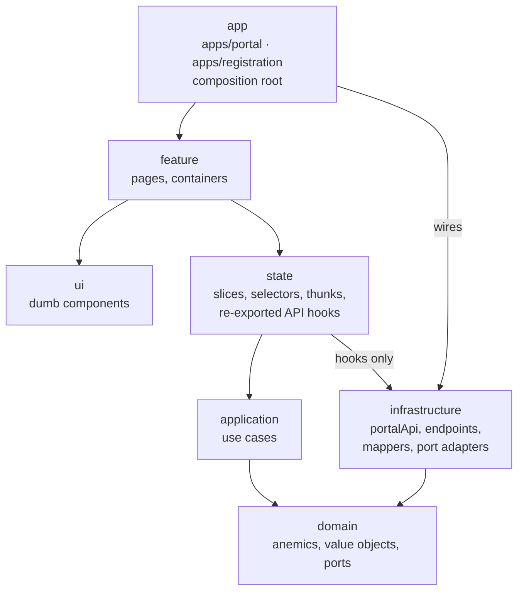

# Portal Frontend – Architecture Guide

This folder is the step-by-step, high-level architecture for the new portal frontend (`portal-nx`).
It is written for the developers who build it: read it once front to back, then use the chapters as reference while implementing.

> Scope: this architecture covers **the frontend only**. How the API is built internally is decided by the API team.
> Wherever this guide talks about the API, it describes what the frontend **expects** from the API contract.

## Reading order

| # | Chapter | What you learn |
|---|---------|----------------|
| 01 | [Principles](./01-principles.md) | The guardrails every decision follows |
| 02 | [Workspace & tooling](./02-workspace-and-tooling.md) | How the Nx workspace is set up, versions, lint rules |
| 03 | [Layers & libs](./03-layers-and-libs.md) | The onion layers, what goes where, folder conventions |
| 04 | [Auth & session](./04-auth-and-session.md) | Why there is no Keycloak in the frontend and how login works |
| 05 | [Data flow & Redux Toolkit](./05-data-flow-redux.md) | RTK Query, mappers, use cases, DI container |
| 06 | [Runtime config & deployment](./06-runtime-config-and-deployment.md) | `config.json`, Docker, Kubernetes |
| 07 | [Routing & permissions](./07-routing-and-permissions.md) | Page registry, guarded routes, menus |
| 08 | [UI & shared libs](./08-ui-and-shared-libs.md) | MUI wrappers, layout, i18n, error handling |
| 09 | [Testing](./09-testing.md) | What to test in which layer and how |
| 10 | [Implementation roadmap](./10-implementation-roadmap.md) | Phases 0–7 with tasks and definition of done |
| 11 | [Recipe: adding a bounded context](./11-adding-a-context.md) | Copy-paste walkthrough for a new context |
| 12 | [Decisions](./12-decisions.md) | Decision log with reasons |

## The architecture on one page

An arrow means **"may import"**. Everything else is blocked by `@nx/enforce-module-boundaries`.

## Glossary

| Term | Meaning in this project |
|------|-------------------------|
| Bounded context | A business area with its own set of libs, e.g. `marketplace`, `identity`, `administration` |
| Anemic entity ("anemic") | A plain, immutable data type without behaviour. Behaviour lives in use cases and domain services |
| Value object | A small typed value, e.g. `Bpn`, `Email`, `PermissionKey`. The type sits in `valueObjects/`, validation and creation in a factory in `factories/` |
| Port | An interface in `domain/repositories` that the domain needs, e.g. `AppRepository` |
| Adapter | An implementation of a port in `infrastructure`, e.g. `AppRtkRepository` |
| Use case | A class in `application` that runs one business operation |
| BFF | Backend-for-frontend: the new API handles OIDC with Keycloak and gives the browser a session cookie |
| Composition root | The app (`apps/portal`): creates store, DI container, router and providers. No business code |

## Source material

- Battleplan (German/English docs) and the kickoff slide decks contain the same decisions in short form.
- Legacy code for reference: `portal-frontend` is the main reference for every migration step; `portal-frontend-registration` for the registration app; `portal-shared-components` for UI components. Nothing is deleted in those repos.
