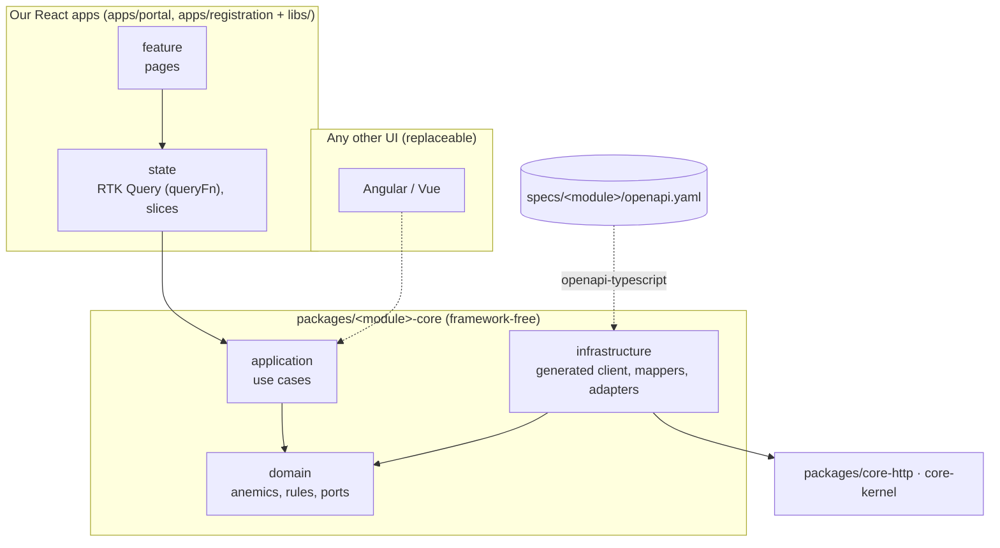

# Portal Frontend – Architecture Guide

This folder is the step-by-step, high-level architecture for the new portal frontend (`portal-nx`).
It is written for the developers who build it: read it once front to back, then use the chapters as reference while implementing.

> Scope: this architecture covers **the frontend only**. How the API is built internally is decided by the API team.
> Wherever this guide talks about the API, it describes what the frontend **expects** from the API contract.

## The idea in three sentences

The frontend is as dumb as possible: business decisions and everything OSP-specific live in the backend. The little frontend logic that remains – which calls belong to an action, in which order, how data is mapped – lives in **framework-free core packages**, one per backend module, generated on top of the module's `openapi.yaml`. Our two React apps (`apps/portal`, `apps/registration`) consume them through the workspace, and the UI on top stays replaceable.

## Reading order

| # | Chapter | What you learn |
|---|---------|----------------|
| 01 | [Principles](./01-principles.md) | The guardrails every decision follows |
| 02 | [Workspace & tooling](./02-workspace-and-tooling.md) | Workspace layout, versions, tags, lint rules |
| 03 | [Layers & libs](./03-layers-and-libs.md) | The five parts of a module and where your code goes |
| 04 | [Core packages](./04-core-packages.md) | Framework-free use case packages generated from `openapi.yaml`, with the "register a company" example |
| 05 | [Auth & session](./05-auth-and-session.md) | Why there is no Keycloak in the frontend; `@portal/identity-core` |
| 06 | [Data flow & Redux Toolkit](./06-data-flow-redux.md) | How our React portal consumes the core packages |
| 07 | [Runtime config & deployment](./07-runtime-config-and-deployment.md) | `config.json`, Docker, Kubernetes |
| 08 | [Routing & permissions](./08-routing-and-permissions.md) | Page registry, guarded routes, menus |
| 09 | [UI & shared libs](./09-ui-and-shared-libs.md) | MUI wrappers, layout, i18n, error handling |
| 10 | [Testing](./10-testing.md) | What to test where and how |
| 11 | [Implementation roadmap](./11-implementation-roadmap.md) | Phases 0–7 with tasks and definition of done |
| 12 | [Recipe: adding a module](./12-adding-a-module.md) | Step-by-step walkthrough for a new backend module |
| 13 | [Decisions](./13-decisions.md) | Decision log with reasons |
| 14 | [Example: company registration in OSP 2.0](./14-example-registration.md) | One complete building block: EBW-Connector (C5-M1), Registration (C1-M2), Process Orchestration |

## The architecture on one page

An arrow means **"may import"** (or, for the spec, "is generated from"). Everything else is blocked by lint.

## Glossary

| Term | Meaning in this project |
|------|-------------------------|
| OSP | Operating service provider. OSP-specific behaviour lives in the backend; the frontend stays dumb |
| Module | A backend module with its own `openapi.yaml` and, on our side, one core package plus `state` and `feature` libs (e.g. `marketplace`, `identity`, `registration`) |
| Core package | `packages/<module>-core`: framework-free workspace package with data types, use cases and HTTP adapters for one module; not published |
| Anemic entity ("anemic") | A plain, immutable data type without behaviour. Behaviour lives in use cases and domain services |
| Value object | A small typed value, e.g. `Bpn`, `PermissionKey`. The type sits in `valueObjects/`, validation and creation in a factory in `factories/` |
| Port | An interface in `domain/repositories` that a use case needs, e.g. `AppRepository` |
| Adapter | An implementation of a port in a core package's `infrastructure`, e.g. `AppHttpRepository` |
| Use case | A class in `application` that runs one operation a UI may trigger, reads included |
| BFF | Backend-for-frontend: the API handles OIDC with Keycloak and gives the browser a session cookie |
| Composition root | An app (`apps/portal`, `apps/registration`): creates the core modules, store, router and providers. No business code |

## Source material

- Battleplan docs and kickoff slide decks contain the earlier decisions in short form; this guide supersedes them where they differ.
- Legacy code for reference: `portal-frontend` is the main reference for every migration step; `portal-frontend-registration` for the registration flow; `portal-shared-components` for UI components. Nothing is deleted in those repos.
